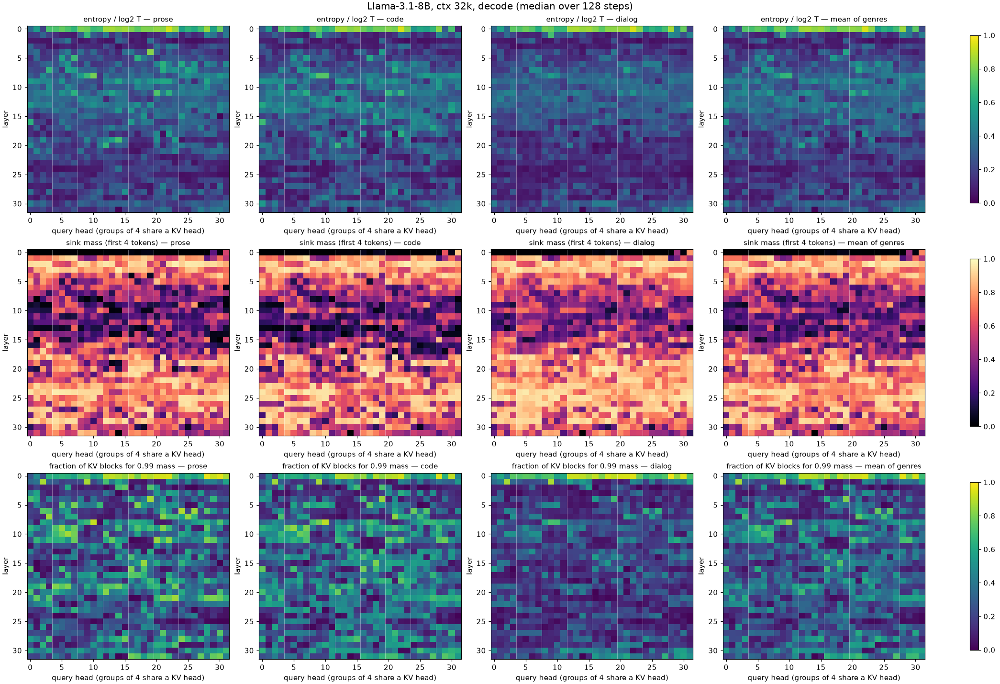
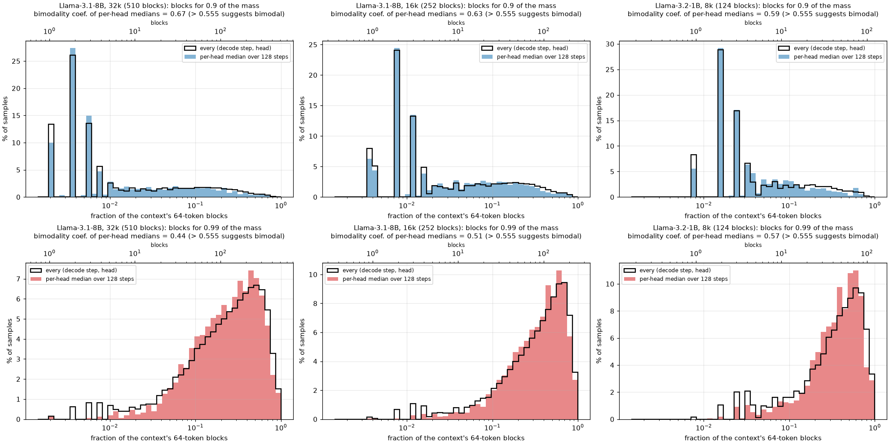
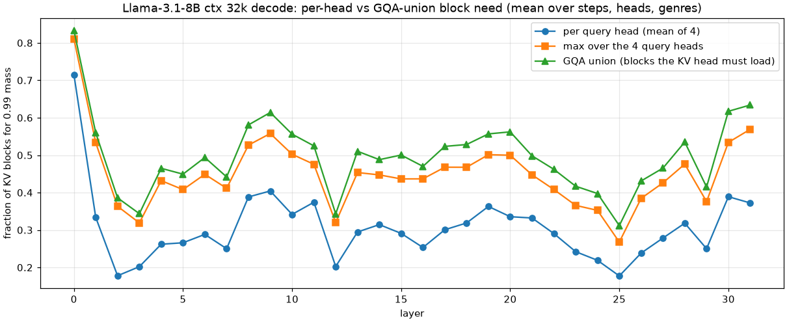
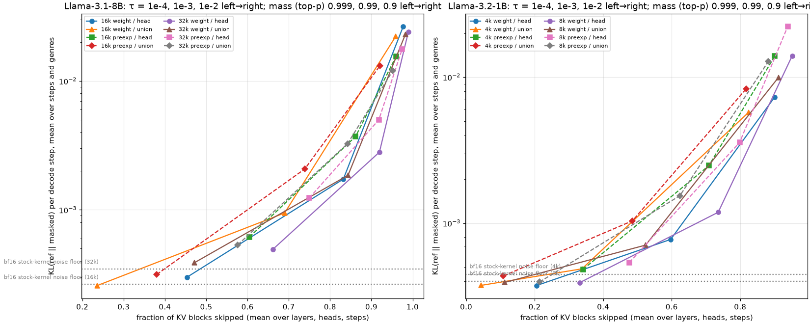
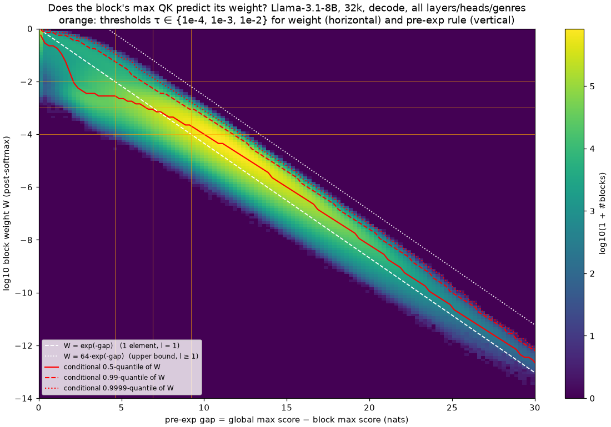
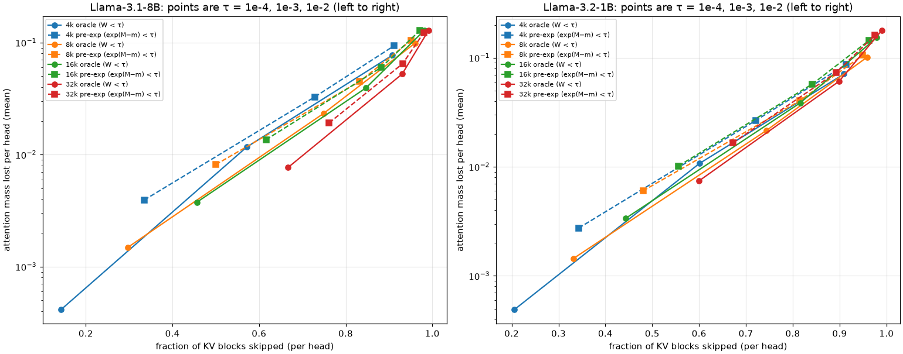

# Attention sparsity — дайджест этапа 1

*12 окт 2026 · Llama-3.2-1B-Instruct, Llama-3.1-8B-Instruct (bf16) · RTX 4090 · kickoff: `docs/01-decode-sparsity.md`*

## TL;DR

- **Всё из kickoff сделано, кроме ядра (по плану).** Окружение, `probe`-attention в HF transformers 5.19, статистика decode по слоям × головам × KV-блокам для 1B и 8B на 4k–32k × 3 жанра, абляция с маскированием блоков.
- **Масса внимания: компактное «тело» и диффузный хвост.** У половины голов 90% массы лежит в 1–3 блоках (sink + последние токены). Но на 99% массы нужно 25–50% блоков: на 8B/32k голова в среднем тянет 156 из 510 блоков (31%).
- **С ростом контекста разреженность растёт.** У 8B число нужных блоков растёт как ~T^0.8, доля для 99% массы падает 49% → 31% от 4k к 32k.
- **GQA-union съедает заметную часть выигрыша.** KV-голове нужно в 1.6× больше блоков, чем средней query-голове, и всего на ~10% больше, чем худшей из четырёх. На 32k это 50% блоков.
- **Абляция, 8B/32k, union по GQA:**
  - τ=1e-4 — бесплатно (KL на уровне шума стокового bf16-ядра), выкидывается 47% блоков;
  - τ=1e-3 — 84% блоков, KL ×5 от шума, совпадение top-1 97.7%;
  - τ=1e-2 — 98% блоков, теряется 20% массы, KL ×66.
- **Top-p лучше фиксированного порога.** Если держать минимальный набор блоков с 99% массы головы (8B, 16k, union), выкидывается 37% блоков при KL на уровне шума. Порог τ=1e-4 при том же качестве даёт только 24%. Подробности в §7.
- **«Шаг расхождения greedy» — шумная метрика.** Даже стоковый bf16 SDPA расходится с fp32-эталоном (в 8 из 12 документов, самое раннее — на 7-м шаге). Сравнивать нужно по KL относительно шума.
- **Pre-exp критерий работает как ранжирование, но порог надо калибровать.**
  - max(QK) блока ранжирует блоки почти как оракул: для 99% массы нужно лишь на 5–6% больше блоков; Spearman 0.96.
  - Порог exp(M−m) < τ некалиброван: для гарантии уровня W < τ нужен запас ~2.5 nats (τ × 0.1).
- **Выбор блоков стабилен во времени.** Набор «99% массы» 16-шаговой давности покрывает 97% массы на текущем шаге.
- **Quest-оценка через min/max ключей блока-64 слабая:** нужно ×1.55 блоков относительно оракула.
- **Вывод для ядра.**
  - В decode неважно, принимать решение до exp или после: экспоненты дешёвые, дорого грузить K.
  - Оправдано уже сейчас: двухпроходный split-K decode, пропускающий V-блоки по GQA-union. Это −24% байт KV на 32k бесплатно и −42% при τ=1e-3.
  - Следующий шаг — пропускать и K, переиспользуя выбор блоков между шагами. Это нужно сначала проверить абляцией.

## 1. Что сделано

**Окружение.** `.venv` (Python 3.11) с torch 2.14.1+cu126 (major 12 совпадает с nvcc 12.5; драйвер 580 / CUDA 13.0), transformers 5.19.0, triton 3.8 и ninja. Smoke-тест (`src/smoke_test.py`):

- 1B в bf16 генерирует 50 токенов;
- `sdpa` / `eager` / `probe` переключаются на лету через `model.set_attn_implementation`;
- greedy-вывод `probe` совпадает с SDPA токен в токен.

**Probe** (`src/probe_attn.py`) регистрируется как `"probe"` через `AttentionInterface`, вместе с SDPA-маской через `AttentionMaskInterface`.

- **Prefill** (q_len > 1) идёт через SDPA чанками по 2048. Иначе 8B на 32k не влезает: пик 19.8 GB.
- **Decode** (q_len = 1) — чистый PyTorch: QKᵀ и softmax в fp32 с материализацией, статистика считается на GPU.
- **Проверка.** Выход decode-attention против fp64 на реальных q/k/v даёт относительную ошибку 3.4e-7. У bf16-ядер она 1.9e-3 (SDPA) и 5.3e-3 (eager) — это округление выхода в bf16.

**Данные** (`src/prepare_data.py` → `data/docs/*.json`):

| жанр | источник | вопрос (ответ — в самом начале документа) |
|---|---|---|
| проза | «The Moors and the Fens», т. 1 (1858), Gutenberg #77931, выложен 14.02.2026, т.е. после cutoff Llama 3.x | как называется дом, кто дал имя, что видно из окон |
| код | `transformers/generation/utils.py` v5.19, с 364-й строки (код 2025–26 гг.) | объясни класс `DeferredStopCheck` |
| диалог | 28 разговоров UltraChat (≥10 реплик), склеены в один чат через chat template | какой был мой первый вопрос и что ты ответил |

**Сценарий прогона:**

- промпт ≈ ctx − 128 токенов, вопрос стоит в конце;
- затем 128 шагов greedy decode (подавлять EOS ни разу не пришлось);
- последний токен промпта подаётся первым decode-шагом, поэтому все 128 шагов идут через probe;
- блок KV = 64 токена начиная с позиции 0, sink = первые 4 токена.

**Объём:** 1B и 8B × 4k/8k/16k/32k × 3 жанра = 24 прогона сбора. Kickoff требовал 1B на 4–8k и 8B на 16–32k; остальные длины добавлены ради трендов. Абляция: 1B 4k/8k и 8B 16k/32k.

**Качество ответов при точном внимании:**

- 8B верно отвечает на прозе и коде на всех длинах;
- на диалоге 8B верен на 4k/8k, а на 16k и 32k путает первый вопрос даже без маскирования (см. §8).

## 2. Карта layer × head (8B, 32k, decode)



Медианы по 128 шагам decode. Полная таблица 32×32 с разбивкой по жанрам — `results/tables/8b_32768_layer_head.csv`, по слоям — `8b_32768_by_layer.csv`.

| слои | энтропия / log₂T | sink mass | блоков до 0.9 | блоков до 0.99 (из 510) |
|---|---|---|---|---|
| 0 | 0.75 | 0.003 | 194 | 375 |
| 1–7 | 0.08–0.29 | 0.44–0.89 | 2–3 | 54–158 |
| 8–11 | 0.32–0.38 | 0.26–0.37 | 7–15 | 157–196 |
| 12–17 | 0.26–0.37 | 0.19–0.52 | 3–8 | 83–146 |
| 18–29 | 0.10–0.20 | 0.68–0.85 | 2–3 | 64–169 |
| 30–31 | 0.21–0.27 | 0.53–0.55 | 3–10 | 179–206 |

- **Слой 0 фактически плотный.** Половина голов почти равномерна, sink ≈ 0. Для 99% массы нужно 73% блоков на голову и 83% по union.
- **Слои 1–7 и 18–29 — «sink-слои».** 70–85% массы приходится на первые 4 токена, 90% массы — на 2–3 блока.
- **Слои 8–11 (частично 13–14 и 30–31) — «контентная» полоса.** Sink падает до 0.2–0.4, на 90% массы нужно 7–15 блоков. Именно эти головы реально читают контекст.
- **Медиана по всем головам:** sink mass 0.59, нормированная энтропия 0.23.
- **Диалог заметно разреженнее прозы и кода** (нижний ряд тепловых карт).

## 3. Сколько блоков нужно: распределение и бимодальность



| доля голов (медианы по шагам) | 8B 32k | 8B 16k | 1B 8k |
|---|---|---|---|
| 0.9 массы в ≤ 3 блоках | 54% | 49% | 52% |
| 0.9: коэффициент бимодальности | **0.67** | **0.63** | **0.59** |
| 0.99: нужно 10–50% блоков | 62% | 57% | 57% |
| 0.99: нужно ≥ 50% блоков | 20% | 35% | 35% |
| 0.99: коэффициент бимодальности | 0.44 | 0.51 | 0.57 |

Коэффициент бимодальности выше 0.555 указывает на бимодальность.

- **Для 0.9 массы распределение бимодально.** Есть пик на 1–3 блоках (sink + локальное окно, около половины голов) и широкое плато до 100% блоков.
- **Для 0.99 бимодальности нет.** Один широкий горб на 30–60% блоков: последние ~9% массы размазаны по контексту практически у всех голов. Это главный ограничитель пропуска блоков.

**Масштаб по контексту** (среднее по головам, шагам и жанрам):

| | 4k | 8k | 16k | 32k |
|---|---|---|---|---|
| блоков в контексте | 61 | 124 | 252 | 510 |
| 8B: блоков до 0.9 (среднее / медиана) | 7.3 / 3 | 10.9 / 3 | 20.6 / 3 | 27.9 / 3 |
| 8B: блоков до 0.99 | 30 (49%) | 54 (43%) | 101 (40%) | 156 (31%) |
| 1B: блоков до 0.99 | 27 (44%) | 51 (41%) | 104 (41%) | 187 (37%) |

- **8B:** нужные блоки растут как ~T^0.79, так что доля падает с длиной.
- **1B:** рост ~T^0.93, почти пропорционально контексту — внимание маленькой модели более размытое.

## 4. GQA-union vs per-head



| 8B | 4k | 8k | 16k | 32k |
|---|---|---|---|---|
| доля блоков до 0.99, средняя query-голова | 49% | 43% | 40% | 31% |
| то же, худшая голова группы | 66% | 60% | 57% | 45% |
| то же, union (что грузит KV-голова) | 72% | 66% | 63% | 50% |
| union / средняя голова | 1.48 | 1.54 | 1.56 | 1.63 |
| пропуск при W < 1e-4: per-head / union | 14% / 3% | 30% / 11% | 46% / 24% | 67% / 48% |
| пропуск при W < 1e-3: per-head / union | 57% / 33% | 75% / 56% | 85% / 71% | 93% / 86% |

- **Union всего на ~10% хуже худшей головы группы.** Цену определяет «самая жадная» голова, а не расхождение между головами.
- **По слоям** union хуже всего в слое 0 (83%), в слоях 8–11 и 30–31 (53–63%); лучше всего — в слоях 2–3, 12 и 25 (31–39%).
- **Для decode важен только union.** Блок KV грузится, если он нужен хотя бы одной из 4 голов. Пропуск по отдельной голове экономит FLOPs, но не байты.

## 5. Абляция: KL и расхождение текста

**Метод:**

- prefill точный и общий для всех условий;
- эталон — fp32 probe без масок, 128 шагов greedy;
- в маскированном варианте выброшенные блоки исключаются до softmax с перенормировкой, как в блочно-разреженном ядре, которое их просто не грузит;
- **teacher forcing на эталонных токенах** даёт KL(ref ‖ masked) на каждом шаге и совпадение top-1;
- **свободный greedy** даёт шаг первого расхождения и сам текст.

Шаг первого расхождения при teacher forcing совпал со свободным greedy в 100% прогонов (проверка согласованности).

**Шумовой пол.** Стоковый HF bf16 decode (SDPA или eager) против fp32-эталона даёт KL 2.6–4.5e-4 на шаг (p95 ≈ 1.5e-3). В 8 из 12 документов greedy-текст стокового ядра расходится с эталоном раньше 128-го шага, самое раннее — на 7-м. Расхождения на почти-ничьих в логитах неизбежны, поэтому шаг расхождения сам по себе мало что значит.

**8B, 32k** (шум KL = 3.5e-4; «—» = не разошлось за 128 шагов):

| условие | пропущено блоков | потеря массы | KL, × шум | top-1 | расхождение prose / code / dialog |
|---|---|---|---|---|---|
| стоковый bf16 SDPA | — | — | 0.9 | 99.5% | 35 / — / — |
| W < 1e-4, union | 47% | 0.4% | **1.1** | 99.5% | 35 / 34 / — |
| W < 1e-4, per-head | 66% | 0.8% | 1.4 | 99.5% | 19 / — / — |
| W < 1e-3, union | 84% | 4.3% | 5.3 | 97.7% | 60 / 15 / 25 |
| W < 1e-3, per-head | 92% | 5.9% | 8.1 | 96.9% | 17 / 15 / 55 |
| W < 1e-2, union | 98% | 20% | 66 | 94.5% | 19 / 15 / 16 |
| pre-exp 1e-4, union | 58% | 1.1% | 1.5 | 98.7% | 19 / 34 / 91 |
| pre-exp 1e-3, union | 84% | 5.9% | 9.4 | 97.9% | 60 / 15 / 16 |
| pre-exp 1e-2, union | 95% | 16% | 35 | 95.1% | 17 / 15 / 16 |

**8B, 16k, union** (шум KL = 2.6e-4):

| условие | пропущено | потеря массы | KL, × шум | top-1 |
|---|---|---|---|---|
| W < 1e-4 | 24% | 0.1% | 1.0 | 99.2% |
| W < 1e-3 | 69% | 2.7% | 3.6 | 99.2% |
| W < 1e-2 | 96% | 18% | 84 | 95.3% |
| pre-exp 1e-4 | 38% | 0.6% | 1.2 | 99.7% |
| pre-exp 1e-3 | 74% | 4.7% | 7.9 | 98.4% |

**1B** даёт ту же картину с меньшим выигрышем:

- 1e-4 с union: выкидывается 4–11% блоков, бесплатно;
- 1e-3 с union: 34–52% блоков, KL ×1.1–1.8 от шума;
- 1e-2 с union: 82–91% блоков, KL ×13–25.

Все таблицы — в `results/tables/ablation_*.csv`.



**Выводы:**

- **Качество определяет потерянная масса, а не τ.** Потеря 0.4% массы — это шум, ~4% дают ×5, ~20% дают ×66.
- **Фиксированный τ не инвариантен к длине контекста.** При τ=1e-3 потеря массы на голову растёт с 1.2% (4k) до 5.2% (32k), потому что под порог попадает всё больше блоков, и KL растёт вместе с ней. Критерий лучше формулировать через массу (top-p, §7).
- **Union против per-head.** При том же τ у union KL обычно в ~1.5 раза ниже (разброс 1.0–2.2). Поскольку байты в decode экономит только union, per-head-пропуск в decode бессмыслен.
- **Pre-exp против оракула.** При равной экономии (84% блоков, union, 32k) KL у pre-exp в 1.7 раза выше (3.3e-3 против 1.9e-3). Зато при τ=1e-4 pre-exp выкидывает больше (58% против 47%) и остаётся у шума (×1.5).
- **Текст.** Даже при τ=1e-2 (98% блоков выброшено, потеряно 20% массы) 8B верно отвечает на прозе («Paradise»), меняется только цитируемый отрывок. Объяснение кода остаётся корректным. На диалоге 32k неверен уже сам эталон, а маскирование лишь меняет, какой неверный ответ получается.

## 6. Pre-exp критерий: max(QK) блока против реального вклада



**Корреляция.** Spearman между max QK блока и его весом (по голове и шагу):

- 8B: медиана растёт с длиной от 0.93 (4k) до 0.96 (32k), p05 — от 0.82 до 0.91;
- 1B: медиана 0.95–0.97;
- хуже всего в почти равномерных головах слоя 0 (до 0.81).

**Вид связи** (2D-гистограмма по 200 млн блоков, 8B, 32k):

- log₁₀W ≈ −gap/ln10 + const с разбросом около одного порядка, где gap = m − M_b;
- теоретическая граница 64·e^(−gap) не достигается никогда.

**Калибровка правила «пропустить, если exp(M_b − m) < τ»** (8B, 32k):

| τ | порог по gap | доля «ложных» пропусков (W ≥ τ) | порог для < 0.1% ложных |
|---|---|---|---|
| 1e-4 | 9.2 nats | 14.5% | 11.7 nats (τ × 0.08) |
| 1e-3 | 6.9 nats | 2.2% | 8.9 nats (τ × 0.14) |
| 1e-2 | 4.6 nats | 0.15% | 5.1 nats (τ × 0.6) |

**Ранжирование по M_b** (экстра-метрика): если брать блоки в порядке убывания max QK, для 99% массы нужно лишь на 5–6% больше блоков, чем оракулу (8B, 4k–32k); для 90% массы — на 6–9% больше.



**Вердикт:** решать «пропустить» до exp можно.

- max QK блока — почти оракульный предиктор вклада.
- Порог нужно сдвинуть на ~2–2.5 nats. Альтернатива — брать топ блоков по M_b до бюджета массы.
- В trade-off «доля пропуска ↔ потерянная масса» кривая pre-exp лежит чуть выше оракула, и с ростом контекста разрыв сокращается.

## 7. Экстра: дешёвые предикторы, переиспользование выбора, top-p

Этого не было в kickoff, но эти данные прямо отвечают на вопрос «какое ядро писать».

**8B, среднее по головам, шагам и жанрам:**

| | 4k | 8k | 16k | 32k |
|---|---|---|---|---|
| блоков до 0.99: оракул | 30 | 54 | 101 | 156 |
| по max QK блока (pre-exp) | 31 (×1.05) | 57 (×1.05) | 107 (×1.05) | 166 (×1.06) |
| по Quest-оценке min/max K (без загрузки K) | 41 (×1.37) | 77 (×1.43) | 148 (×1.46) | 242 (×1.55) |
| масса, покрытая набором 0.99 с прошлого шага | 98.4% | 98.3% | 98.3% | 98.2% |
| то же, набор 16-шаговой давности | 97.3% | 97.2% | 97.1% | 97.2% |
| p05 этой массы (16 шагов) | 92% | 91% | 91% | 91% |

Переиспользованный набор берётся вместе с 2 последними блоками.

- **Quest на блоках по 64 токена слабый.** Медианный запас оценки — 20–21 nats над реальным max блока; блоков нужно ×1.4–1.55, и с длиной контекста отношение ухудшается. Блоки 16–32 токена, скорее всего, помогли бы, но это не измерялось.
- **Набор блоков почти не меняется во времени.** Выбор 16-шаговой давности покрывает 97% массы при том же числе блоков. Это аргумент за ядро, которое делает полный проход раз в N шагов, а между ними грузит только выбранные блоки — тогда экономится и K. Абляция с такими масками — следующий эксперимент.

**Top-p абляция (оракул):** держим минимальный набор блоков, дающий 0.9 / 0.99 / 0.999 массы головы.

Результаты для 8B, 16k (среднее по трём жанрам; шум KL = 2.6e-4):

| условие | пропущено блоков | потеря массы | KL, × шум | top-1 |
|---|---|---|---|---|
| top-p 0.999, union | 11% | 0.03% | 1.0 | 99.7% |
| **top-p 0.99, union** | **37%** | 0.4% | **1.0** | 99.7% |
| top-p 0.99, per-head | 59% | 1.0% | 1.5 | 99.5% |
| top-p 0.9, union | 80% | 5.4% | 10.5 | 98.7% |
| для сравнения: W < 1e-4, union | 24% | 0.1% | 1.0 | 99.2% |
| для сравнения: W < 1e-3, union | 69% | 2.7% | 3.6 | 99.2% |

- При том же качестве (на уровне шума) top-p 0.99 выкидывает в 1.5 раза больше блоков, чем порог 1e-4. При этом он сам подстраивается под длину контекста.
- Отрезать 10% массы (top-p 0.9) уже заметно: KL ×10.
- 32k и 1B досчитываются, догоню отдельным сообщением.

## 8. Странное

1. **Слой 0 плотный.** Около половины голов почти равномерны. Например, голова (0, 22): энтропия 0.94·log₂T, sink 0.4%, 95% блоков для 0.99 массы. Слой 0 разумно всегда считать плотно — это 1/32 стоимости attention.
2. **Чисто локальная голова (31, 14).** 99.8% массы лежит на последних 64 токенах, максимальный вес 0.99 — на одном токене. По сути это голова «предыдущий токен».
3. **Головы, сильно зависящие от входа (слои 17–21).** (21, 23), (21, 22), (17, 17), (19, 5) на прозе требуют 72–86% блоков, а на диалоге — 12–24%. Статический бюджет на голову не сработает, выбор должен быть динамическим.
4. **Диалог разреженнее.** На 32k union до 0.99 у 8B равен 36% против 56–57% у прозы и кода. Гипотеза (не проверял): служебные токены chat template работают как дополнительные sink.
5. **Головы «sink + равномерный фон».** Например, (0, 31): 78% массы на sink, но для 99% нужно 72% блоков.
6. **Длинный диалог ломается и без всякой разреженности.** 8B на 16k/32k называет неверный «первый вопрос» при точном внимании; 1B путает реплики. Это стоит учитывать при оценке качества по тексту.
7. **Шума bf16 (~1e-4…1e-3 nats KL на шаг) хватает, чтобы перевернуть greedy на почти-ничьих.** Разреженные ядра нужно сравнивать с fp32-эталоном по KL, а не по «совпадению текста».

## 9. Что это значит для ядра

1. **В decode разница «до exp / после exp» по стоимости несущественна.** T экспонент на голову — ничто по сравнению с загрузкой K/V, а после QK точные веса блоков почти бесплатны. Результат про pre-exp важен для prefill (там упор в вычисления) и как сигнал ранжирования.
2. **Любой критерий на основе QK требует прочитать весь K.** Значит, реалистичное первое ядро экономит только V. Схема — двухпроходный split-K flash-decoding:
   - **(а) QK по блокам** для KV-головы сразу с её 4 query-головами (GQA-упаковка); на выходе max и sumexp по блоку;
   - **(б) редукция:** m, l, веса блоков и маска как union по группе, по порогу или top-p;
   - **(в) PV только по оставленным блокам.**

   Ожидание на 8B/32k:
   - τ=1e-4: −47% V-блоков, это ≈ −24% байт KV, качество на уровне шума. Top-p 0.99 на 16k даёт ещё в 1.5 раза больше пропуска при том же качестве; 32k досчитывается;
   - τ=1e-3: −84% V-блоков (≈ −42% байт), KL ×5.

   Выигрыш растёт с контекстом. Учтите масштаб: на bs=1 KV для 32k — это 4.3 GB против 16 GB весов за шаг. Заметным в целом шаге выигрыш станет при batch ≥ 4–8 или контексте 64k+.
3. **Больший выигрыш — пропускать и K.** Для этого нужен выбор блоков без K. Данные говорят за переиспользование выбора во времени: набор 16-шаговой давности покрывает 97% массы. Quest на блоках 64 проигрывает (×1.55 блоков). Следующие эксперименты:
   - абляция с масками переиспользования: полный проход раз в N = 4/8/16/32 шагов;
   - Quest на блоках 16/32.
4. **Бейзлайн для ядра** — FA2 decode (`flash_attn_with_kvcache`) и SDPA на 4090. Метрика — мкс на шаг decode при batch 1/8/32 и контексте 32k–128k.
5. **Слой 0 оставить плотным.**

## 10. Ограничения

- По одному документу на жанр, 128 шагов decode. Вопрос стоит в самом начале документа — худший случай по дальности.
- Нет 64k–128k и нет Qwen3-8B.
- Статистика prefill не собиралась, по плану только decode.
- KL считается с teacher forcing; качество текста оценено глазами.
- Границы блоков жёсткие, по 64 токена от позиции 0.
- Экстра-метрики (Quest, переиспользование) считаются по query-голове; варианты для union не считались.

## 11. Как воспроизвести

```bash
.venv/bin/python src/smoke_test.py
.venv/bin/python src/run_collect.py --model 8b --ctx 4096 8192 16384 32768 --out results/collect_v2
.venv/bin/python src/run_ablate.py  --model 8b --ctx 16384 32768              # пороги + шумовой пол
.venv/bin/python src/run_ablate.py  --model 8b --ctx 16384 32768 --grid mass  # top-p
.venv/bin/python src/analyze.py --collect results/collect_v2                  # таблицы и графики
```

**Время:** сбор 8B/32k занимает ~30 с на документ; основная абляция — 4–5 мин на документ 32k.

**Где что лежит:**

- графики — `results/figures/`;
- таблицы — `results/tables/` (csv и md);
- сырые данные (parquet) — `results/collect*/`, `results/ablate/`;
- входы — `data/docs/`.
