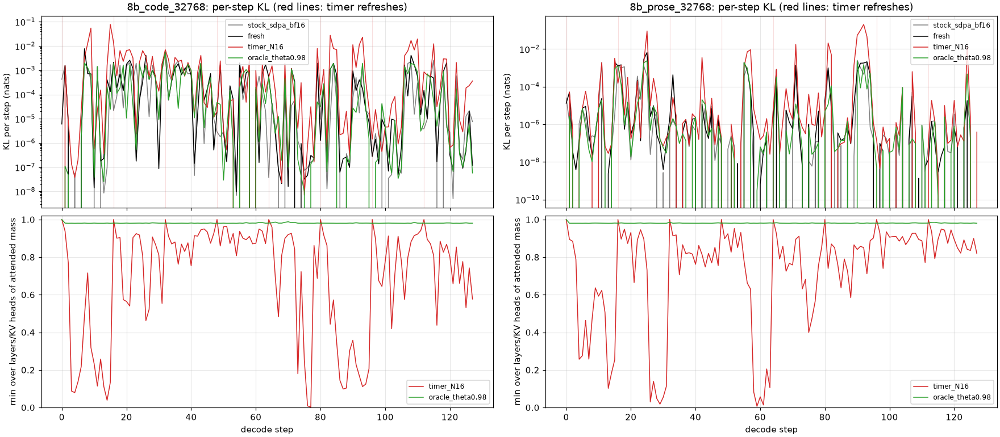
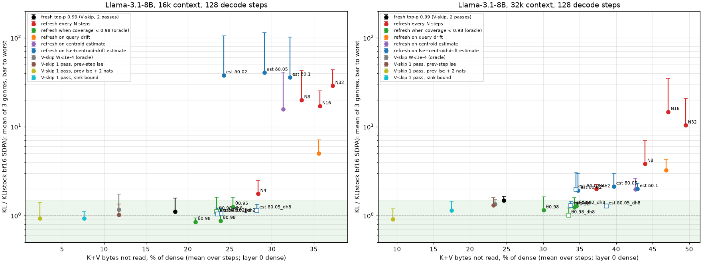
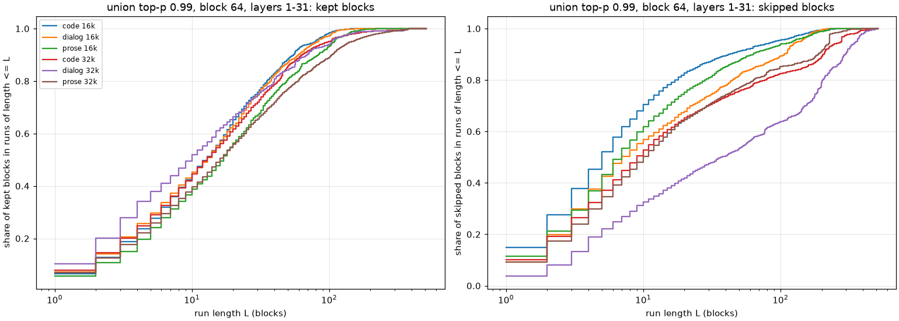
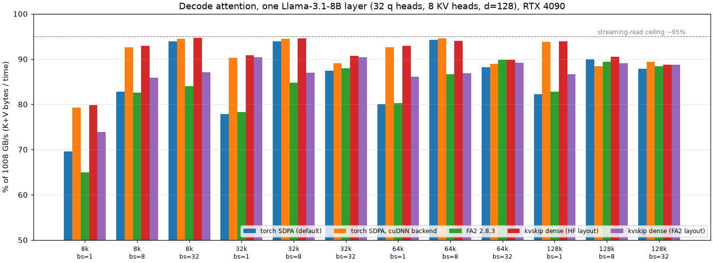

# kvskip — дайджест этапа 2: какое ядро и пол под него

*12–13 окт 2026 · Llama-3.1-8B-Instruct (bf16) · RTX 4090 · kickoff: `docs/02-core.md`*

## TL;DR

- **Развилка решена в пользу K+V-skip, но refresh должен идти по триггеру, а не по таймеру.**
  - Таймер не проходит decision gate: при N=8 KL в 3.8 раза выше шума на 32k и до ×43 на 16k, при N=16 — ×15–17 в среднем и до ×35.
  - Причина — «прыжки»: на одном шаге до 107 из 248 KV-голов теряют покрытие разом, сильнее всего слои 8–10 и 13–16.
  - Refresh отдельной головы по дешёвому сигналу держит KL у шума: ×1.28 в среднем по жанрам, ×1.34 в худшем. Сигнал — оценка потерянной массы по центроидам ключей блоков, плюс refresh раз в 32 шага и 8 голов всегда точно.
  - Так пропускается 39% байт K+V на 32k (на диалоге 53%) против 25% у V-skip. Проверено на трёх новых документах (held-out): ×1.43 / ×1.49, 38% байт.
- **Плотное ядро: 88–95% от 1008 GB/s везде, кроме 8k bs=1 (80%), — это потолок карты (потоковое чтение — 956 GB/s).**
  - FA2 2.8.3 медленнее везде: kvskip даёт 1.00–1.23× его пропускной способности.
  - На 32k, bs=8 — 1126 мкс против 1256 мкс (×1.12 при цели ≥ 0.85). Наравне с cuDNN-бэкендом SDPA.
  - Ошибка vs fp64 на реальных дампах 1.83e-3 (bf16-выход), у FA2 1.89e-3. На первом же прогоне, без единого исправления в ядре.
- **Разреженные режимы — в том же семействе ядер, время идёт ровно за байтами.**
  - Маскированное ядро при 50% блоков — ×0.52 от плотного, при 10% — ×0.12.
  - Однопроходный V-skip с нормировкой с прошлого шага: ×0.80 при 80% байт.
  - Двухпроходный V-skip с буфером P (вариант из чата): ×0.86 по ядрам. С Python-планировщиком он медленнее плотного (×1.25 на bs=8, ×3.7 на bs=1) — планировщик надо сливать в ядро.
- **Ядра внутри 8B воспроизводят probe** (32k, bs=1): refresh ×1.3–1.7 от шума при 48–73% прочитанных блоков; сам dense kvskip ×0.84–1.43 — это разброс двух bf16-ядер.
  - Время шага: dense = SDPA (~25 мс), однопроходный V-skip на 0.3–1.5 мс быстрее.
  - На bs=1 attention — только ~18% шага.
- **Однопроходный V-skip (идея из чата) работает, и запас не нужен.**
  - Нормировка с прошлого шага даёт ровно то же, что оракул: 46% V при τ=1e-4 на 32k, KL ×1.3.
  - Запас в 2 nats срезает пропуск до 19%. Строгая нижняя граница по sink-блоку безопасна, но даёт только 35%.
- **A2: маски кусками.** Прогоны по ~5 блоков, ~80% блоков в прогонах ≥ 4. Списка блоков ядру хватает. Блок 32 вместо 64 сэкономил бы ещё ~7% байт, 128 — потерял бы ~7%.
- **A3: накопления ошибки нет.** Perplexity на 2048 токенах продолжения после 32k контекста:
  - все три разреженных режима неотличимы от точного: |ΔPPL| ≤ 0.07%, |ΔNLL| в пределах одной стандартной ошибки;
  - стоковый bf16 SDPA сдвигает сильнее: +0.12% на прозе;
  - последние 1024 токена не хуже первых 256.
- **A4: «диалог разреженнее» — подтверждается на двух документах на жанр (38% и 41% блоков против 53–59%).**
  - Служебные токены как дополнительные sink — не механизм: вставленные в прозу, они ничего не меняют (57% → 57%).
  - Но тот же диалог без chat template — 50%: шаблон объясняет ~60% разницы через структуру реплик, а не через сами токены.

## 1. Что сделано

| дорожка | что | где |
|---|---|---|
| B0 | дампы реальных q/k/v: 8B, 32k, слои 0/9/21/31, шаги 0/1/16/64, три жанра (+ маски top-p 0.99) | `src/dump_kv.py` → `data/kv_dumps/` |
| B1 | харнесс: сборка `cpp_extension.load` (sm_89), проверка vs fp64 на дампах, тайминг CUDA events с прогоном L2, медиана из 50 | `bench/harness.py`, `bench/test_decode.py` |
| B2 | бейзлайны: SDPA (все бэкенды) и FA2 2.8.3 (`flash_attn_with_kvcache`), 12 конфигураций | `bench/bench_decode.py` |
| B3 | плотное split-K flash-decoding ядро: raw CUDA, GQA-упаковка, FMA + cp.async | `kernels/kvskip_kernel.cu` |
| B4 | маска блоков (список), режим stats, двухпроходный V-skip (P в fp16), однопроходный V-skip, планировщик refresh | `kernels/`, `src/kvskip_attn.py` |
| A1 | переиспользование выбора: таймер, оракул, три дешёвых триггера, «всегда точные» головы, held-out | `src/reuse.py`, `src/run_reuse.py` |
| A2 | длины прогонов масок, размер блока 16–128, ранжирование без K (Quest 16/32/64, центроид) | там же, на эталонном проходе |
| A3 | perplexity на 2048 токенах продолжения | `src/run_ppl.py` |
| A4 | шаблон как sink: диалог без шаблона, проза со служебными токенами; новый документ на жанр | `src/prepare_a4.py`, `src/run_a4.py` |
| e2e | ядра внутри 8B: KL против эталона и время шага | `src/run_e2e.py` |

Протокол A1 тот же, что в этапе 1:

- промпт ≈ ctx − 128 токенов, 128 шагов greedy-эталона в fp32;
- условия идут с teacher forcing на токенах эталона;
- метрика — KL(эталон ‖ условие) на шаг, делённая на KL стокового bf16 SDPA (шумовой пол), которая считается в том же прогоне.

Слой 0 во всех разреженных условиях плотный.

## 2. A1 — переиспользование выбора

Набор = GQA-union top-p 0.99 голов группы, сохраняется на refresh-шаге. Между refresh грузится только он + блок с sink + 2 последних блока, т.е. и K, и V пропускаются. Refresh-шаг — плотный проход со статистикой блоков (точный выход). Это дешевле, чем stats + masked: те же байты, но один проход.

### 2.1 Таймер: не проходит

8B, 3 жанра. KL — среднее по жанрам / худший жанр, в долях шумового пола. Байты — доля K+V, которую не читаем (усреднено по шагам, включая плотный слой 0 и refresh-шаги).

| условие | 16k: KL × шум | 16k: байт пропущено | 32k: KL × шум | 32k: байт пропущено |
|---|---|---|---|---|
| fresh: top-p 0.99 на каждом шаге (= V-skip, K читается весь) | 1.10 / 1.58 | 18.5% | 1.48 / 1.65 | 24.6% |
| refresh раз в N=4 | 1.76 / 2.48 | 28% | 1.99 / 2.26 | 37% |
| N=8 | 19.9 / 42.8 | 34% | 3.83 / 6.96 | 44% |
| N=16 | 17.1 / 25.3 | 36% | 14.7 / 35.0 | 47% |
| N=32 | 28.9 / 43.8 | 37% | 10.4 / 20.9 | 50% |

По жанрам — таблица N × ctx × жанр, как просил kickoff. KL и p95 KL — в долях шума, top-1 — совпадение argmax с эталоном:

| условие | ctx | проза: KL× / p95× / top-1 | код: KL× / p95× / top-1 | диалог: KL× / p95× / top-1 | K / V пропущено |
|---|---|---|---|---|---|
| fresh (V-skip) | 16k | 0.73 / 0.75 / 100% | 1.00 / 1.02 / 98.4% | 1.58 / 1.45 / 100% | 0% / 37% |
| fresh (V-skip) | 32k | 1.65 / 1.61 / 98.4% | 1.32 / 1.02 / 99.2% | 1.47 / 1.11 / 98.4% | 0% / 49% |
| N=4 | 16k | 1.62 / 0.85 / 100% | 2.48 / 3.02 / 97.7% | 1.18 / 1.67 / 100% | 28% / 28% |
| N=4 | 32k | 2.26 / 1.95 / 100% | 2.00 / 1.96 / 99.2% | 1.69 / 1.75 / 99.2% | 37% / 37% |
| N=8 | 16k | 13.9 / 9.0 / 100% | 3.08 / 3.14 / 97.7% | 42.8 / 23.6 / 100% | 34% / 34% |
| N=8 | 32k | 6.96 / 1.96 / 98.4% | 3.14 / 2.61 / 98.4% | 1.40 / 1.14 / 99.2% | 44% / 44% |
| N=16 | 16k | 10.4 / 4.40 / 100% | 15.5 / 23.3 / 97.7% | 25.3 / 11.9 / 99.2% | 36% / 36% |
| N=16 | 32k | 35.0 / 16.0 / 100% | 7.40 / 6.95 / 97.7% | 1.71 / 1.38 / 98.4% | 47% / 47% |
| N=32 | 16k | 17.5 / 9.03 / 98.4% | 25.3 / 41.2 / 96.1% | 43.8 / 51.7 / 99.2% | 37% / 37% |
| N=32 | 32k | 7.62 / 4.83 / 98.4% | 20.9 / 23.5 / 96.1% | 2.60 / 3.21 / 97.7% | 50% / 50% |
| триггер (итог, §2.4) | 16k | 0.78 / 0.68 / 100% | 1.33 / 1.37 / 98.4% | 1.34 / 1.50 / 100% | 28% / 28% |
| триггер (итог, §2.4) | 32k | 1.34 / 1.20 / 99.2% | 1.19 / 0.99 / 99.2% | 1.30 / 1.03 / 99.2% | 39% / 39% |

- **Decision gate («N ≥ 8 при KL на уровне шума») по букве не пройден.** Хуже всего проза и код; диалог на 32k терпит даже N=16 (×1.7).
- **Не монотонно по N:** на 16k N=8 хуже N=16. KL определяется редкими событиями, и важно, попал ли refresh сразу после них.
- top-1 совпадение держится 96–99% даже при ×40: прыжки бьют по распределению, а не по argmax.



### 2.2 Прыжки: есть, где и как выглядят

- **Прыжок — массовое событие.** На худшем шаге N=32 (код, 16k) 107 из 248 KV-голов разом теряют больше 5% массы: модель переключается на другой участок контекста. На графике у таймера минимальное покрытие между refresh падает почти до нуля.
- **Где.** Доля шагов, на которых устаревший набор покрывает < 0.95 (N=32, 32k):
  - слои 8–10 и 13–16 — 18–29%;
  - слои 18–28 — 7–14%;
  - слои 1, 3–4, 29 и 31 — 0–5%.

  То есть та самая «контентная» полоса из этапа 1, шире, чем 8–11.
- **Отдельный класс — одиночные головы ранних слоёв.** Голова (2, 5) теряет больше 5% массы на 53% шагов. На диалоге 16k именно она даёт пики KL при покрытии 0.6–0.8. Похоже на голову «предыдущее вхождение текущего токена»: её цель — один ключ, который прыгает вместе с токеном.

### 2.3 Предсказуемо ли: да, по оценке потерянной массы

Оракул — refresh головы, когда её устаревший набор покрывает < 0.98 точной массы (нужен полный проход, это верхняя граница):

- KL ×0.85…1.15 в среднем, refresh 4–5% голово-шагов.
- С добавкой «refresh не реже чем раз в 32 шага», чтобы набор не застывал большим (иначе он живёт с шага 0): ×0.87…1.24, пропуск 24% / 34% байт на 16k / 32k.

Дешёвые сигналы — что из них предсказывает «покрытие < 0.95» (AUROC, 6 документов):

| сигнал | цена | AUROC |
|---|---|---|
| дрейф запроса: 1 − cos(q, q на refresh) | 0 | 0.75–0.82 |
| возраст набора | 0 | 0.53–0.61 |
| оценка по центроидам: Σ n_b·exp(q·c_b) вне набора | центроиды = 1/64 K | 0.90–0.94 |
| **lse блока с refresh + сдвиг (q − q_r)·c_b** | центроиды + статистика refresh-прохода | **0.95–0.97** |

Последний сигнал откалиброван: на коде 16k медиана оценки потерянной массы совпадает с реальной (0.014 против 0.014), хвост завышается, что для триггера безопасно.

**Но как триггер он сначала провалился:** диалог 16k дал ×100. Виноваты несколько голов, чьи большие потери оценка не видит:

| голова (слой, KV) | доля шагов с потерей > 5% | из них «невидимых» (оценка < 2%) | документов |
|---|---|---|---|
| (2, 5) | 53% | 22% | 6 из 6 |
| (5, 2) | 21% | 4.4% | 6 из 6 |
| (16, 5), (27, 1), (26, 3), (25, 1), (31, 2), (6, 7) | 15–31% | 1.5–3% | 3–5 |

Первые 8 голов дают 44% всех «невидимых» потерь. Это 8 из 256 KV-голов, т.е. ~3% байт, если держать их всегда точными.

### 2.4 Итоговая политика и проверка на новых документах

Политика:

- refresh KV-головы, если оценка потерянной массы > δ = 0.05, или если набору 32 шага;
- 8 голов из таблицы выше всегда точные.

Головы выбраны по 6 прогонам на документах этапа 1, затем проверены на трёх новых документах (A4).

| условие | 16k: KL × шум | 16k: байт | 32k: KL × шум | 32k: байт | 32k held-out: KL × шум | 32k held-out: байт |
|---|---|---|---|---|---|---|
| fresh (V-skip) | 1.10 / 1.58 | 18.5% | 1.48 / 1.65 | 24.6% | 1.09 / 1.18 | 24.1% |
| таймер N=16 | 17.1 / 25.3 | 36% | 14.7 / 35.0 | 47% | 10.4 / 23.6 | 46% |
| оракул 0.98 + 32 шага | 0.87 / 1.18 | 24% | 1.24 / 1.58 | 34% | 0.98 / 1.17 | 33% |
| оценка δ=0.05 + 32 шага, без точных голов | 40.7 / 114 | 29% | 2.13 / 2.98 | 40% | — | — |
| **оценка δ=0.05 + 32 шага + 8 точных голов** | **1.15 / 1.34** | **28%** | **1.28 / 1.34** | **39%** | **1.43 / 1.49** | **38%** |
| то же, δ=0.02 | 1.05 / 1.22 | 24% | 1.29 / 1.44 | 34% | 1.22 / 1.45 | 33% |
| δ=0.02 + только 2 точные головы | 1.06 / 1.20 | 24% | 1.98 / 3.09 | 35% | — | — |

- Refresh срабатывает на ~7% голово-шагов, включая 3% от «всегда точных» голов.
- По жанрам на 32k пропускается 30% (проза), 33% (код), 53% (диалог) байт K+V.
- Для сравнения: этап 1 считал «бесплатным» уровень ×1.1–1.5; fresh-V-skip здесь же даёт ×1.1–1.5.



## 3. Однопроходный V-skip (замечание из чата)

Замечание верное. Если второй проход заново читает K, наивный двухпроходный V-skip при τ=1e-4 читает больше плотного.

Сделаны оба варианта, что предлагались в чате:

- **Двухпроходный с P.** Первый проход пишет `exp(s − max блока)` в fp16 — 3% от байт K — и статистику блоков. Второй читает P и V только оставленных блоков.
- **Однопроходный с отложенной загрузкой V.** V блока грузится после его QK, если хоть одной голове группы нужна масса ≥ τ. PV отстаёт на тайл, так что загрузка V перекрывается с QK следующего тайла.

Чем оценить нормировку внутри split-K, где глобального m нет — проверено в probe (τ = 1e-4, GQA-union, 3 жанра):

| нормировка | 16k: V пропущено | 16k: KL × шум | 32k: V пропущено | 32k: KL × шум |
|---|---|---|---|---|
| точная (оракул, правило этапа 1) | 23.6% | 1.17 | 46.8% | 1.34 |
| **lse с прошлого шага, без запаса** | 23.5% | 1.02 | 46.3% | 1.30 |
| lse с прошлого шага, запас 2 nats | 4.8% | 0.93 | 18.8% | 0.91 |
| lse sink-блока (строгая нижняя граница) | 15.2% | 0.93 | 35.0% | 1.15 |

- **lse прошлого шага — практически оракул.** Нормировка между шагами почти не двигается, так что запас не нужен: он лишь съедает пропуск.
- **Строгая граница по sink-блоку** (каждый CTA сам считает lse блока 0, никакого состояния между шагами) гарантирует, что ни один блок с весом ≥ τ не выброшен. Цена — четверть пропуска: в «контентных» головах sink держит только 20–40% массы.
- В ядре `vskip1` есть оба режима: `lse_prev` на входе или граница по sink.

## 4. A2 — локальность масок

GQA-union top-p 0.99, слои 1–31, 128 шагов, 3 жанра:

| | 16k | 32k |
|---|---|---|
| оставлено блоков по 64 | 61.4% | 48.7% |
| средний прогон оставленных / пропущенных (в блоках) | 5.7 / 3.7 | 5.1 / 5.5 |
| блоков в прогонах ≥ 4: оставленных / пропущенных | 82% / 68% | 79% / 80% |

Размер блока (доля оставленных токенов при том же top-p 0.99):

| блок | 16 | 32 | 64 | 128 |
|---|---|---|---|---|
| 16k | 53.9% | 57.6% | 61.3% | 65.1% |
| 32k | 41.9% | 45.2% | 48.6% | 52.0% |



Средний прогон по числу прогонов — ~5 блоков. Если считать по блокам, половина оставленных блоков лежит в прогонах длиннее ~12 блоков (~770 токенов). На диалоге 32k пропущенные блоки идут особенно длинными кусками: половина — в прогонах ≥ 30 блоков.

- **Списка блоков хватает.** Блок 64 в раскладке HF — это 16 КБ подряд на голову. Накладные расходы на блок (индекс, адрес) в ядре не видны: время маскированного ядра идёт за байтами (§7.3). Runs ничего не добавят.
- **Каждое удвоение блока стоит ~3.5 п.п. токенов (~7% байт).** 128 невыгоден. 32 сэкономил бы ~7%, но удвоит метаданные и число итераций; оставляю 64.
- **Выбор без чтения K** (сколько блоков нужно для 0.99, относительно оракула, 16k / 32k):
  - max QK блока: ×1.06 / ×1.07 (нужен K);
  - Quest min/max на 16-токенных подблоках при загрузке по 64 (идея из чата): ×1.26 / ×1.32 — лучше Quest-64 (×1.48 / ×1.60);
  - центроид блока: ×1.31 / ×1.69.

  Для выбора с нуля это проигрывает refresh с точной статистикой. Центроиды полезны как поправка к ней (§2.3), а не вместо неё.

## 5. A3 — perplexity

Возражение было: KL на шаг за 128 шагов с teacher forcing не ловит накопление. Проверка дольше — 2048 шагов, и это настоящий текст документа, а не ответ модели.

**Постановка:**

- после 32768 токенов контекста идут следующие 2048 токенов того же документа: проза и код — сырой текст с BOS, диалог — через chat template;
- продолжение подаётся по одному токену через decode-путь с teacher forcing;
- K и V каждого токена продолжения считаются уже под условием, так что ошибка может копиться все 2048 шагов.

| условие | проза: PPL (Δ) | код: PPL (Δ) | диалог: PPL (Δ) | ΔNLL ± SE, нат/токен: проза / код / диалог |
|---|---|---|---|---|
| точный fp32 | 13.383 | 3.2891 | 3.5885 | — |
| стоковый bf16 SDPA | 13.399 (+0.12%) | 3.2891 (0.00%) | 3.5873 (−0.03%) | +0.0012±0.0009 / +0.0000±0.0007 / −0.0003±0.0009 |
| fresh top-p 0.99 (V-skip) | 13.382 (−0.01%) | 3.2878 (−0.04%) | 3.5911 (+0.07%) | −0.0001±0.0009 / −0.0004±0.0007 / +0.0007±0.0009 |
| V-skip в 1 проход, lse прошлого шага, τ=1e-4 | 13.375 (−0.06%) | 3.2892 (0.00%) | 3.5889 (+0.01%) | −0.0006±0.0010 / +0.0000±0.0008 / +0.0001±0.0010 |
| refresh по оценке + 8 точных голов (итог §2.4) | 13.377 (−0.05%) | 3.2908 (+0.05%) | 3.5906 (+0.06%) | −0.0005±0.0011 / +0.0005±0.0008 / +0.0006±0.0010 |

ΔNLL итоговой политики по окнам продолжения (токены 0–256 / 256–1024 / 1024–2048):

- проза: −0.0024 / +0.0026 / −0.0022;
- код: +0.0020 / +0.0004 / +0.0002;
- диалог: +0.0023 / −0.0008 / +0.0012.

Роста к концу нет.

- **Все разреженные режимы в пределах одной стандартной ошибки от точного.** По модулю они не больше сдвига от округления стокового bf16.
- **Накопления через KV сгенерированных токенов за 2048 шагов не видно** ни у V-skip, ни у K+V-skip с refresh.
- **Ограничение:** чувствительность этого теста — ~0.002–0.003 нат/токен (3 документа × 2048 токенов). KL на шаг из A1 тоньше. Оба теста согласны.

## 6. A4 — шаблон чата и новые документы

32k, 64 шага decode, слои 1–31. «Блоков для 0.99» — доля блоков, нужная KV-голове (union).

| документ | блоков для 0.99 | sink-масса | масса на служебных токенах | служебных токенов в промпте |
|---|---|---|---|---|
| проза (этап 1) | 56.9% | 0.55 | 0.010 | 6 |
| проза 2 — «Sinbad», 1923, Gutenberg #77919 (2026) | 53.3% | 0.54 | 0.009 | 6 |
| код (этап 1) | 57.7% | 0.53 | 0.006 | 6 |
| код 2 — `transformers/trainer.py` 5.19 | 58.8% | 0.53 | 0.007 | 6 |
| диалог (этап 1) | **38.0%** | 0.61 | 0.034 | 696 (2.1%) |
| диалог 2 — UltraChat, seed 1 | **41.1%** | 0.59 | 0.032 | 594 (1.8%) |
| тот же диалог 1 без шаблона («User: … / Assistant: …» в одном сообщении) | 49.7% | 0.56 | 0.011 | 6 |
| проза 1 + граница реплики шаблона каждые 2 абзаца | 56.9% | 0.54 | 0.020 | 552 (1.7%) |

- **«Диалог разреженнее» теперь n=2 на жанр:** 38–41% против 53–59%.
- **Гипотеза «служебные токены — дополнительные sink» не подтверждается как механизм.**
  - На них приходится лишь ~3% массы.
  - Вставленные в прозу с той же частотой, они вдвое увеличивают свою долю массы, а разреженность прозы не меняют (56.9% → 56.9%).
- **Шаблон при этом важен.** Тот же текст диалога без шаблона нуждается в 49.7% блоков вместо 38%: это ~60% разницы с прозой. Похоже, модель с шаблоном читает разговор как последовательность отдельных сообщений и смотрит в основном в текущую реплику. Оставшиеся ~7 п.п. — сам жанр.
- Held-out-документы ведут себя как документы этапа 1 и в A1 (§2.4). Таймер N=16 снова ×2.4–24, refresh по оценке ×1.30–1.49.

## 7. B — ядро

### 7.1 Бейзлайны и плотная версия

Один слой Llama-3.1-8B (32 q-головы, 8 KV, d=128), bf16, мкс на шаг decode (медиана из 50 после прогона 256 МБ через L2) и доля от 1008 GB/s:

| ctx | bs | SDPA (по умолчанию) | SDPA cuDNN | FA2 2.8.3 | **kvskip** | kvskip / FA2 |
|---|---|---|---|---|---|---|
| 8k | 1 | 47.9 мкс (70%) | 42.0 (79%) | 51.2 (65%) | **41.7 (80%)** | 1.23 |
| 8k | 8 | 322 (83%) | 288 (93%) | 323 (83%) | **287 (93%)** | 1.13 |
| 8k | 32 | 1134 (94%) | 1128 (95%) | 1267 (84%) | **1126 (95%)** | 1.13 |
| 32k | 1 | 171 (78%) | 148 (90%) | 170 (78%) | **147 (91%)** | 1.16 |
| 32k | 8 | 1134 (94%) | 1128 (95%) | 1256 (85%) | **1126 (95%)** | 1.12 |
| 32k | 32 | 4871 (88%) | 4784 (89%) | 4846 (88%) | **4695 (91%)** | 1.03 |
| 64k | 1 | 333 (80%) | 288 (93%) | 332 (80%) | **287 (93%)** | 1.16 |
| 64k | 8 | 2260 (94%) | 2253 (95%) | 2457 (87%) | **2267 (94%)** | 1.08 |
| 64k | 32 | 9657 (88%) | 9584 (89%) | 9490 (90%) | **9482 (90%)** | 1.00 |
| 128k | 1 | 647 (82%) | 568 (94%) | 643 (83%) | **567 (94%)** | 1.13 |
| 128k | 8 | 4738 (90%) | 4820 (88%) | 4768 (89%) | **4708 (91%)** | 1.01 |
| 128k | 32 | 19393 (88%) | 19055 (89%) | 19274 (88%) | **19196 (89%)** | 1.00 |



- **Потолок карты — 956 GB/s (95% от паспорта)**: свой потоковый 16-байтный read-kernel. `torch.sum` даёт 800–950 и нестабилен, им мерить нельзя.
- **kvskip упирается в этот потолок:** на 8k bs=32 и 32k bs=8 — 954 GB/s.
- **Дизайн ядра.**
  - grid (split, KV-голова, batch), 128 потоков; одна KV-голова обслуживает свои 4 q-головы, так что K и V читаются один раз;
  - тайл 64 токена = блок маски; cp.async в shared, 2 стадии;
  - QK: 8 лейнов на токен, 3 xor-шаффла; online softmax — warp на голову; PV — warp на 16 токенов, лейн на 4 измерения;
  - split-K с отдельным ядром редукции;
  - 188 регистров, без спиллов.
- **Тензорные ядра не понадобились.** FMA-путь с запасом укладывается в бюджет: ~4000 warp-инструкций на тайл на CTA, т.е. ~1000 тактов на 4 планировщиках. За это время память отдаёт одному SM только четверть тайла (~10 000 тактов на тайл).
- **bs=1 на коротком контексте** (8k, 80%) упирается в запуск: 32 МБ на слой — это 35 мкс работы. Помогут CUDA graphs на весь шаг.
- **Раскладка.** На раскладке FA2 `[B, T, Hkv, D]` то же ядро до 8 п.п. медленнее при bs ≤ 8 (при bs=32 вровень): тайл головы — это 64 строки по 256 Б с шагом 2 КБ. Раскладка HF `[B, Hkv, T, D]` для пропуска блоков лучше.

### 7.2 Корректность

Против fp64 на дампах: 3 жанра × 4 слоя × 4 шага, 32k, с реальными gap'ами QK в 20–30 nats.

| проверка | max отн. ошибка |
|---|---|
| kvskip, bf16-выход (split 1 / 7 / авто, обе раскладки, batch 12) | 1.83e-3 |
| стоковый SDPA bf16 | 1.89e-3 |
| FA2 bf16 | 1.89e-3 |
| kvskip, fp32-выход (сама арифметика ядра) | 9.0e-6 |
| маскированное, против референса с той же маской (fp32) | 2.6e-6 |
| статистика блоков: max / sumexp | 8.8e-6 nats / 7.4e-6 отн. |
| двухпроходный V-skip (P в fp16), fp32 | 8.1e-5 |
| однопроходный V-skip, fp32 (доли оставленных блоков совпадают с референсом точно) | 7.7e-7 |

Синтетические крайние случаи тоже проходят:

- d = 64 и T не кратно 64;
- T = 33 при 3 сплитах, T = 3000 при 64 сплитах — пустые сплиты;
- sink с gap ~30 nats.

### 7.3 Разреженные режимы

Реальные маски из дампов (top-p 0.99 union + sink + 2 последних блока), 32k. Время — относительно плотного ядра на тех же данных:

| режим | bs=1: время | bs=1: прочитано K / V | bs=8: время | bs=8: прочитано K / V |
|---|---|---|---|---|
| маскированное (шаг без refresh: K и V только набора) | ×0.65 | 61% / 61% | ×0.56 | 51% / 51% |
| однопроходный V-skip, lse с прошлого шага | ×0.84 | 100% / 64% | ×0.80 | 100% / 60% |
| однопроходный V-skip, граница по sink | ×0.91 | 100% / 79% | ×0.86 | 100% / 70% |
| двухпроходный V-skip (P), только ядра | ×0.87 | 100% / 62% | ×0.86 | 100% / 57% |
| то же + Python-планировщик (softmax, сортировка, план) | ×3.72 | | ×1.25 | |

Маскированное ядро на синтетических масках (прогоны по 1–8 блоков), время относительно плотного:

| оставлено | 75% | 50% | 25% | 10% |
|---|---|---|---|---|
| 32k, bs=1 | ×0.78 | ×0.54 | ×0.31 | ×0.16 |
| 32k, bs=8 | ×0.77 | ×0.52 | ×0.27 | ×0.12 |
| 128k, bs=8 | ×0.75 | ×0.47 | ×0.24 | ×0.10 |

- **Время идёт за байтами** почти идеально. Отставание от идеала заметно только на bs=1 при < 25%, где мало работы на SM.
- **Python-планировщик пока дороже, чем экономит.** На bs=1 десяток мелких запусков на слой стоят больше, чем 150-мкс слой. В рабочем варианте выбор top-p и триггер должны быть одним ядром.

### 7.4 Ядра внутри модели

Те же 128 шагов, что в A1, но attention всех слоёв decode идёт через CUDA-ядра (`src/kvskip_attn.py`): эталон — fp32 probe, условия — teacher forcing. 8B, 32k, bs=1. KL — в долях стокового bf16 SDPA.

| режим | проза | код | диалог |
|---|---|---|---|
| kvskip dense | ×0.84 | ×1.23 | ×1.43 |
| V-skip в 2 прохода (top-p 0.99) | ×1.22 | ×1.13 | ×1.23 |
| V-skip в 1 проход, lse прошлого шага | ×1.44 | ×1.04 | ×1.27 |
| V-skip в 1 проход, граница по sink | ×1.01 | ×0.84 | ×1.37 |
| refresh по оценке + 8 точных голов | ×1.69 | ×1.28 | ×1.49 |
| refresh: прочитано блоков K+V (слои 1–31) | 73% | 71% | 48% |
| refresh: доля голов с refresh на шаге | 8.1% | 8.4% | 7.5% |

- **Ядра в модели воспроизводят probe.** Однопроходный V-skip ×1.44 / ×1.04 / ×1.27 против ×1.41 / ×0.91 / ×1.59 в fp32-probe. Refresh ×1.69 / ×1.28 / ×1.49 против ×1.34 / ×1.19 / ×1.30.
- **Шум двух bf16-ядер между собой — ×0.84–1.43.** Плотное kvskip само по себе так же далеко от SDPA, как SDPA от fp32. Разреженные режимы лежат в той же полосе, чуть выше fp32-probe: ошибка bf16 и маски складываются (замечание из чата). Разница в пределах разброса шума.
- **Прочитанные блоки** (73 / 71 / 48%) учитывают честную цену реализации: на шаге с триггером сработавшая голова сначала проходит masked, потом плотно. Probe считал только плотный проход.

Время шага decode всей модели, мс (медиана, `GrowingCache` без `torch.cat`, CUDA events вокруг forward):

| режим | проза | код | диалог |
|---|---|---|---|
| стоковый SDPA | 26.8 | 25.6 | 25.4 |
| kvskip dense | 27.4 | 25.4 | 25.3 |
| V-skip в 1 проход, lse прошлого шага | 25.3 | 24.9 | 25.0 |
| V-skip в 1 проход, граница по sink | 26.8 | 25.5 | 24.8 |
| V-skip в 2 прохода + Python-планировщик | 48.5 | 44.3 | 43.9 |
| refresh + Python-планировщик | 67.1 | 61.9 | 59.2 |

- **На bs=1 / 32k attention — ~18% шага.** KV — 4.3 ГБ на шаг (~4.6 мс), веса — 16 ГБ.
  - Даже идеальный пропуск 40% KV дал бы −1.8 мс (−7%).
  - Однопроходный V-skip даёт −0.3…−1.5 мс, как и следует из его −23% байт. Других накладных расходов у него нет.
- **Режимы с Python-планировщиком сейчас в 1.7–2.5 раза медленнее.**
  - Десяток мелких запусков и синхронизации на каждый из 32 слоёв стоят 0.6–1.3 мс на слой. Это больше, чем стоит сам слой attention.
  - Вывод тот же, что в §7.3: планировщик — следующая работа, ядра уже готовы.
- **Один замер в первом прогоне был выбросом** (V-skip на диалоге, 39.9 мс). Повтор на 64 шагах дал 25.0 мс, в таблице — повтор.

## 8. Что сломалось и как чинилось

1. **FA2 не ставился.** Под torch 2.14 готовых колёс нет, а сборка из исходников падала: заголовкам torch 2.14 нужен C++20 (`std::strong_ordering`), setup.py FA2 жёстко ставит `-std=c++17`. Патч флагов, сборка только sm_80 (на sm_89 работает), 5 параллельных задач: 68 минут.
2. **Само ядро ошибок не дало.** Все проверки на дампах прошли с первого запуска. Тесты специально включали gap'ы в 20–30 nats, неполные тайлы, пустые сплиты и больше сплитов, чем тайлов.
3. **Харнесс ломался трижды.**
   - Батчевый fp64-референс просил 12 ГБ на einsum → считаю по одному элементу.
   - Strided-view держал 4 ГБ буфера живым → OOM на bs=32/128k.
   - Первый полный прогон бенча упал до записи CSV → CSV пишется по ходу.
4. **«Потолок» через `torch.sum` гулял от 800 до 950 GB/s** (частоты GPU не прогреты). Заменён своим read-kernel с прогревом: 956 GB/s стабильно.
5. **Дешёвый триггер дал ×100 на диалоге.** Одна голова (2, 5) делала то, что центроидная оценка не видит → калибровка «всегда точных» голов, проверенная на held-out.
6. **`DynamicCache` из HF делает `torch.cat` всего KV на каждом шаге:** это ~2× байт KV лишней записи/чтения на шаг. Для e2e-замеров написан `GrowingCache` — буфер с удвоением и views.

## 9. Решение и что дальше

**Ядро:** одно семейство, планировщик выбирает режим.

- **Основной режим — K+V-skip с refresh по триггеру:**
  - masked-проход по сохранённому набору;
  - оценка потерянной массы по центроидам (1/64 байт K);
  - для сработавших голов — плотный проход со статистикой в том же шаге;
  - слой 0 и 8 откалиброванных голов всегда плотные.
- **Запасной режим — однопроходный V-skip с lse прошлого шага.** Нужен там, где выбор нестабилен, и для голов, которые всегда точные.

Ожидание на 8B/32k:

- −39% байт K+V (на held-out −38%) при KL ×1.3–1.5 от шума;
- на диалоге −53%;
- V-skip даёт −25%.

**Этап 3:**

1. **Слить планировщик в ядра.** Выбор top-p union по статистике блоков — один CTA на голову, nb ≤ 2048. Оценку триггера — в маскированное ядро. Потом CUDA graph на весь шаг decode. Без этого на bs=1 выигрыш съедает Python.
2. **e2e на том, где KV доминирует:** bs 8–32 и/или 64k–128k. На bs=1/32k KV — это 4.3 ГБ против 16 ГБ весов за шаг, т.е. пропуск 40–50% KV даёт лишь ~7–9% на токен.
3. **Калибровка «всегда точных» голов** — автоматическая, по одному прогону diag. Проверить, переносится ли список на Qwen3-8B (у неё свои головы-копировщики).
4. **Блок 32 вместо 64** (−7% байт) — только после слияния планировщика: метаданных станет вдвое больше.
5. **Prefill** — отдельная история: там важен pre-exp-ранг из этапа 1, а не байты.

## 10. Как воспроизвести

```bash
# FA2 2.8.3 под torch 2.14: распаковать sdist, -std=c++17 -> -std=c++20 в setup.py, затем
FLASH_ATTN_CUDA_ARCHS=80 FLASH_ATTENTION_FORCE_BUILD=TRUE MAX_JOBS=5 NVCC_THREADS=1 \
  uv pip install --python .venv/bin/python --no-build-isolation ./flash_attn-2.8.3.post1

.venv/bin/python src/dump_kv.py                                    # B0, ~3 мин
.venv/bin/python bench/test_decode.py                              # корректность
.venv/bin/python bench/bench_decode.py --backends sdpa sdpa_all fa2 kvskip --tag dense
.venv/bin/python bench/bench_sparse.py
.venv/bin/python src/run_reuse.py --ctx 16384 32768                # A1 main + A2, ~20 мин
.venv/bin/python src/run_reuse.py --ctx 16384 32768 --grid diag    # сигналы триггера, V-skip-правила
DH=dh=2.5,5.2,16.5,27.1,26.3,25.1,31.2,6.7
.venv/bin/python src/run_reuse.py --ctx 16384 32768 --grid trig2 --cond estd:0.05:32:$DH estd:0.02:32:$DH
.venv/bin/python -I src/prepare_a4.py                              # новые документы (data/raw)
.venv/bin/python src/run_reuse.py --ctx 32768 --grid heldout --doc prose2 code2 dialog2 \
    --cond fresh timer:16 oracle:0.98:32 estd:0.05:32:$DH
.venv/bin/python src/run_a4.py
.venv/bin/python src/run_ppl.py --ctx 32768 --cond fresh vprev:0.0001 estd:0.05:32:$DH   # A3, ~1 ч
.venv/bin/python src/run_e2e.py --ctx 32768 --delta 0.05 --dense-heads 2.5 5.2 16.5 27.1 26.3 25.1 31.2 6.7 --timing
.venv/bin/python src/analyze_stage2.py
```

Сырые данные (parquet, json) — в `results/{reuse,ppl,e2e,template,bench}`, таблицы — `results/tables/stage2_*`, графики — `results/figures/stage2_*`.
