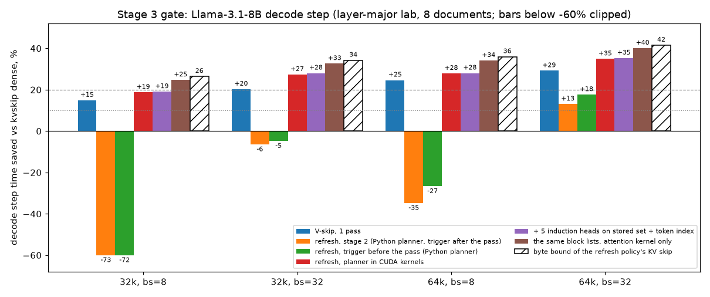
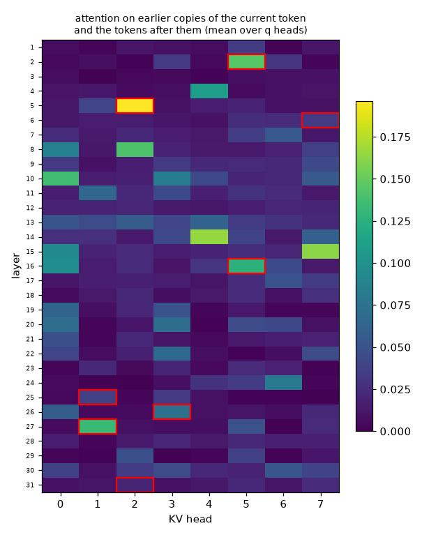
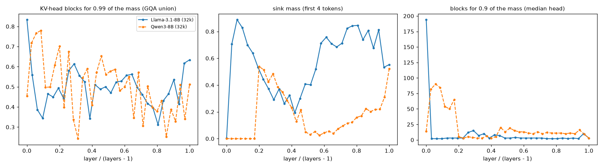

# kvskip — дайджест этапа 3: есть ли выигрыш там, где он должен быть

*13 окт 2026 · Llama-3.1-8B-Instruct (bf16), Qwen3-8B · RTX 4090 · kickoff: `docs/03-gate.md`*

## TL;DR

- **Gate пройден, и не только по границе.** Пропуск K+V с refresh по триггеру сокращает шаг decode всей модели:

  | | плотный шаг | планировщик в CUDA-ядрах | граница по байтам |
  |---|---|---|---|
  | bs=8, 32k | 58.4 мс | **−19%** | 26% |
  | bs=32, 32k | 173.6 мс | **−27%** | 34% |
  | bs=8, 64k (точка gate) | 95.8 мс | **−28%** | 36% |
  | bs=32, 64k | 323.7 мс | **−35%** | 42% |

  - Качество то же, что в этапе 2: KL ×1.3–1.4 от шума bf16 на 8 документах.
  - До границы не хватает 7–8 п.п. Из них 5–6 — два ядра планировщика (0.1–0.5 мс на слой). Ещё 1–2 — само ядро внимания: те же списки блоков без планировщика дают −25…−40%.
- **Python-планировщик этапа 2 на трёх точках из четырёх замедляет шаг на 5–73%.** Выигрыш (−13…−18%) он даёт только при bs=32/64k: около 80 мелких операций на слой упираются в CPU.
  - Планировщик переписан в два CUDA-ядра без синхронизаций с хостом.
  - Решения совпадают с Python-версией на 100% голово-шагов, выходы — бит в бит.
- **Сетка kickoff на 4090 не влезает, и это записано, а не обойдено.**
  - При bs=8/32k KV всех слоёв — 32 ГиБ рядом с 15 ГБ весов, при bs=32/64k — 256 ГиБ.
  - Поэтому сделана «послойная лаборатория»: точная модель идёт по слоям над батчем из 8 документов, в памяти один слой.
  - Шаг собирается из реальных вызовов слоя HF на реальных данных.
  - Сверка с настоящей моделью там, где она влезает: плотное ядро на bs=1/32k — 24.2 мс в лаборатории против 24.7 мс в модели.
- **Разложение шага.** При bs=8/64k веса — 15 ГБ, KV — 69 ГБ (82% байт), attention — 73% времени плотного шага.
  - Всё остальное занимает 26 мс при идеале 16 мс: eager-HF гоняет веса на ~60% полосы.
  - В движке с CUDA graphs доля attention была бы выше, а с ней и выигрыш.
- **Однопроходный V-skip без всякого планировщика уже даёт −15…−29% при bs ≥ 8**: он читает весь K и пропускает V. Это нижняя планка, которую K+V-skip обходит на 3–7 п.п.
- **Триггер до прохода — бесплатно по качеству.**
  - На 6 документах при 32k KL ×1.33 против ×1.35, оценка предсказывает потери так же (AUROC 0.917 против 0.926).
  - Двойного чтения нет: прочитано 61% блоков вместо 64%.
  - Главное — нет синхронизации с хостом: без этого перенос в ядра не дал бы ничего.
- **Индекс для «точных» голов.** 5 из 8 голов — индукционные: 8–18% внимания на токене *после* прошлого вхождения текущего токена, у средней головы 1.6%.
  - (2, 5) — самая чистая: 80% sink + 15% индукция + 4% окно.
  - Но индекс один не закрывает полностью ни одну голову. У (2, 5) индекс по токену покрывает 92% массы (19% блоков), по паре токенов — 83% (2% блоков).
  - Как добавка работает: 5 индукционных голов читают сохранённый набор + блоки индекса по токену (с триггером), а не всё. KL ×1.34–1.43 против ×1.27–1.33 с 8 точными головами; refresh на четверть реже, +0.8 п.п. пропуска.
  - Индекс по паре токенов промахивается: ×2.0 при 32k.
- **Qwen3-8B: прыжки и триггер переносятся, список голов — нет.**
  - Таймер ломается так же (×4.6–28), прыжки того же размера: до 86 из 280 KV-голов разом.
  - Триггер без всяких «точных» голов держит ×1.0–1.5 (диалог при 32k ×2.2) при пропуске 34–39% байт.
  - «Невидимые» головы размазаны: 8 худших — 19% потерь против 44% у Llama. Автокалибровка их находит, но качество не меняет.
  - Диалог при 32k приводит в норму порог δ = 0.02 (×1.64), а не головы.
  - Неожиданное: у Qwen3 почти нет sink (медиана 0.13 против 0.66, в слоях 0–6 — ноль), «тело» внимания — окно последних токенов, и слой 0 не плотный (плотные — 1–3). Доля блоков на 99% массы та же: 50% против 49%.

## 1. Что сделано

| фаза | что | где |
|---|---|---|
| 0 | fast-forward `main` на stage-2, теги `stage-1`, `stage-2`; README: три факта о модели наверх | git, `README.md` |
| 1.1 | e2e при bs ∈ {1, 8, 32} × ctx ∈ {4k, 32k, 64k}: послойная лаборатория (8 новых документов ≥ 70k токенов, точные промпты одной длины) + сверка с настоящей моделью | `src/lab.py`, `src/run_batch_e2e.py`, `src/prepare_s3.py`, `src/make_forced.py` |
| 1.2 | разложение шага: веса / KV / прочее, граница по байтам против факта | `src/analyze_stage3.py` |
| 2.1 | индекс token_id → блоки: диагностика по всем головам, политики «индекс вместо точной головы» и «индекс + сохранённый набор» (по токену и по паре токенов) | `src/reuse.py`, `src/run_reuse.py` |
| 2.2 | триггер до прохода: в probe (`estp`) и в ядрах (`refresh_pre`) | `src/reuse.py`, `src/kvskip_attn.py` |
| 3.1–3.3 | планировщик в ядра: `plan` (оценка, решение, список блоков) → masked + stats → `update` (top-p union, ссылки, lse набора); без синхронизаций; тест против Python-версии | `kernels/kvskip_planner.cu`, `bench/test_planner.py` |
| 3.5 | повтор 1.1 с ядрами | `src/lab.py` (раунды s3f, s3g, s3h) |
| 4.1 | Qwen3-8B: карта слоёв, прыжки, «невидимые» головы, индукционные головы | `src/run_collect.py`, `src/run_reuse.py` |
| 4.2 | автокалибровка «точных» голов одним скриптом (на Llama воспроизводит ручной список этапа 2) | `src/calibrate_heads.py` |

Не сделано: CUDA graph на весь шаг (3.4).
- На точках gate шаг упирается в GPU, а не в запуски.
- На bs=1 граф нужен всем режимам сразу, и это отдельная работа: длина T должна жить в памяти устройства, а не приходить параметром с хоста.

## 2. Фаза 1 — есть ли выигрыш вообще

### 2.1 Почему не настоящая модель

KV Llama-3.1-8B — 128 КиБ на токен. Веса — 15.0 ГБ на шаг (с lm_head; таблица эмбеддингов читается строками). На 24-гигабайтной карте рядом с весами остаётся ~6 ГБ.

| | KV всех слоёв | влезает рядом с весами? | KV одного слоя |
|---|---|---|---|
| bs=1, 32k | 4 ГиБ | да (этап 2) | 128 МиБ |
| bs=8, 32k | 32 ГиБ | нет | 1 ГиБ |
| bs=8, 64k | 64 ГиБ | нет | 2 ГиБ |
| bs=32, 32k | 128 ГиБ | нет | 4 ГиБ |
| bs=32, 64k | 256 ГиБ | нет; даже один слой (8 ГиБ) не влезает рядом со всеми весами | 8 ГиБ |

Kickoff предполагал, что не влезет только bs=32/64k. На деле не влезает вся сетка, кроме bs=1. Даже на 80-гигабайтной карте влезла бы только bs=8/32k.

### 2.2 Послойная лаборатория

- **Порядок по слоям.** Точная модель проходит батч из 8 документов слой за слоем.
  - На GPU лежат веса одного слоя и его KV, плюс скрытые состояния всех позиций (4.3 ГБ при 64k).
  - Prefill слоя: FA2 causal и модули HF для всего остального.
- **Decode на учительских токенах.** 128 шагов decode идут на учительских токенах: это ответ модели на тот же вопрос при 32k.
  - При 64k эталонный argmax совпадает с ними в 95% шагов.
  - Каждый шаг — настоящий вызов `LlamaDecoderLayer` с KV-кэшем этого слоя и вниманием режима: kvskip-ядра, планировщик, SDPA, fp32-эталон.
  - При учительских токенах шаги слоя зависят только от прошлых шагов того же слоя (кэш, состояние планировщика) и от выходов предыдущего слоя. Поэтому порядок по слоям считает ровно то же, что обычный decode.
- **Время шага** — сумма времени вызовов слоя (CUDA events) плюс эмбеддинг, rotary, финальная норма и lm_head.
  - bs=32 — четыре копии 8 документов в разной памяти, чтобы L2 не мог их делить.
  - Условие «null» (внимание возвращает нули) отделяет attention от остального слоя.
- **Качество там же.** На позициях decode считаются логиты, отсюда KL против fp32-эталона в долях шума стокового SDPA. Это проверка качества на 64k, которой в этапе 2 не было.
- **Документы.** 8 документов ≥ 70k токенов: 3 прозы, 3 кода, 2 диалога.
  - 4 из них новые: Gutenberg #77959 (2026), три файла torch 2.14 и два длинных чата UltraChat.
  - Промпты ровно одной длины: ядра берут одну длину на батч.

**Сверка с настоящей моделью** там, где KV влезает (те же документы, промпты и учительские токены), мс на шаг:

| | bs=1, 32k: модель / лаборатория | bs=1, 4k | bs=8, 4k |
|---|---|---|---|
| стоковый SDPA | 24.5 / 24.6 | 24.3 / 26.5 | 25.2 / 27.0 |
| kvskip dense | 24.7 / 24.2 | 24.2 / 26.3 | 25.0 / 26.9 |
| V-skip в 1 проход | 23.3 / 28.5 | 24.2 / 26.5 | 24.8 / 27.3 |
| refresh этапа 2 (Python) | 61.3 / 66.7 | 59.7 / 60.7 | 71.7 / 75.0 |
| refresh, триггер до прохода (Python) | 69.5 / 78.2 | 71.2 / 71.3 | 69.8 / 72.2 |

- **Где лаборатория верна.** Там, где слой упирается в GPU, она совпадает с моделью: плотное ядро на 32k — ±2%.
- **Где ошибается.** Там, где слой упирается в CPU (короткий контекст, bs=1, Python-планировщик), лаборатория добавляет ~0.1 мс Python на вызов слоя и переоценивает время на 3–20%.
- **Точки gate (bs ≥ 8, 32k+)** все упираются в GPU: время ядра на слой ≥ 1.4 мс против ~0.7 мс работы CPU. Поэтому bs=1 в таблицах ниже — справочно, его настоящие числа даёт модель.

### 2.3 Таблица gate

Мс на шаг decode всей модели (8 документов, среднее по шагам 8–127) и изменение против kvskip dense того же раунда замеров (плотный шаг между раундами гуляет на ±0.5%):

| режим | 32k, bs=8 | 32k, bs=32 | 64k, bs=8 | 64k, bs=32 |
|---|---|---|---|---|
| стоковый SDPA | 58.6 | 175.6 | 96.0 | 328.1 |
| kvskip dense | 58.4 | 173.6 | 95.8 | 323.7 |
| V-skip в 1 проход | 49.3 (−15%) | 137.8 (−20%) | 72.3 (−25%) | 229.9 (−29%) |
| refresh этапа 2, Python, триггер после прохода | 101.4 (+73%) | 186.0 (+6%) | 129.3 (+35%) | 282.2 (−13%) |
| refresh, Python, триггер до прохода | 99.5 (+72%) | 181.0 (+5%) | 121.4 (+27%) | 267.5 (−18%) |
| **refresh, планировщик в ядрах** | **47.4 (−19%)** | **126.1 (−27%)** | **69.1 (−28%)** | **210.9 (−35%)** |
| то же + 5 индукционных голов на индексе по токену ∪ набор | 47.3 (−19%) | 125.0 (−28%) | 69.0 (−28%) | 209.5 (−35%) |
| те же списки блоков, только ядро внимания | 43.6 (−25%) | 116.4 (−33%) | 63.2 (−34%) | 194.6 (−40%) |
| граница по байтам (пропуск KV × доля KV в байтах шага) | 26% | 34% | 36% | 42% |
| токенов/с: dense → ядра | 137 → 169 | 184 → 254 | 84 → 116 | 99 → 152 |



Прочитано блоков K+V на разреженных слоях (1–31), refresh по триггеру: 61% при 32k и 55% при 64k. С ростом контекста пропуск растёт (этап 2: 16k → 72%). V-skip читает весь K и 52% / 35% V.

**Gate по букве kickoff:**

- Граница при bs=8/64k — 36% (нужно ≥ 20%).
- Факт — 28% с планировщиком в ядрах (нужно ≥ 10%). Даже V-skip без планировщика даёт 25%.

С Python-планировщиком этапа 2 факт был бы −27%. Kickoff ставил его первым пунктом фазы 1, и это ровно тот случай, против которого стоял gate: «граница есть, реализация её съедает». Поэтому фаза 3 сделана в этом же этапе, и таблица выше — уже после неё.

### 2.4 Разложение шага

kvskip dense; attention = время слоя минус время того же слоя с «нулевым» вниманием:

| | веса | KV | доля KV в байтах | идеал при 956 ГБ/с | плотный шаг | из них attention | остальное |
|---|---|---|---|---|---|---|---|
| 32k, bs=8 | 15.0 ГБ | 34.4 ГБ | 70% | 51.6 мс | 58.4 мс | 32.2 мс (55%) | 26.2 мс |
| 32k, bs=32 | 15.0 ГБ | 137 ГБ | 90% | 159 мс | 174 мс | 148 мс (85%) | 26.0 мс |
| 64k, bs=8 | 15.0 ГБ | 68.7 ГБ | 82% | 87.6 мс | 95.8 мс | 69.9 мс (73%) | 25.9 мс |
| 64k, bs=32 | 15.0 ГБ | 275 ГБ | 95% | 303 мс | 324 мс | 298 мс (92%) | 26.1 мс |

- **Плотный шаг целиком — на 88–94% от идеала по байтам.**
- **«Остальное» не зависит от контекста и батча (26 мс), но вдвое медленнее идеала для весов (15.7 мс).**
  - Это eager-HF: ~25 мелких запусков на слой, нормы в fp32, маленькие GEMM.
  - В движке с CUDA graphs и слитыми ядрами оно ушло бы к ~17 мс. Тогда доля attention выросла бы, и выигрыш от пропуска KV — тоже: при bs=8/64k с −28% до ~−31%.
- **Граница по байтам почти достигается ядрами.** «Только ядро внимания» отстаёт от неё на 1–2 п.п. Время ядра идёт за байтами, как и показал этап 2 на одном слое.

## 3. Фаза 3 — планировщик в ядрах

### 3.1 Почему Python-планировщик проигрывал

- **Устройство.** Шаг refresh-режима — около 80 мелких операций PyTorch на слой: оценка, top-p с сортировкой, план, обновление состояния.
- **Цена на CPU.** На любом батче это ~1.5 мс работы CPU на слой.
  - Триггер после прохода добавлял синхронизацию с хостом (`int(trig.sum())`).
  - Триггер до прохода её убрал, но 80 запусков остались.
- **Где это видно.** Выигрыш съедается, пока ядро внимания на слой не перекрывает работу CPU и GPU-часть самих 80 операций.
  - При bs=8/32k ядро идёт ~1 мс: +72%.
  - При bs=32/32k — ~4.6 мс: +5%.
  - При bs=32/64k — ~9 мс: −18%.

### 3.2 Как устроено в ядрах

Шаг слоя — три запуска, ни одной синхронизации.

1. **`plan`** (один CTA на (batch, KV-голова), warp на query-голову):
   - добавляет ключ нового токена в сумму ключей его блока;
   - считает q·c_b для всех блоков: 8 загрузок центроидов в полёте на warp;
   - считает оценку потерянной массы по блокам вне набора: поток на блок, загрузки идут подряд;
   - решает про refresh и пишет список блоков: все для сработавших голов, иначе набор + sink + 2 последних.
2. **masked + stats** — существующее ядро этапа 2 по этому списку.
3. **`update`:**
   - для сработавших голов — новый набор: top-p 0.99 каждой query-головы делением порога пополам (32 итерации по логарифмам весов), union по группе, плюс sink и окно, как `select_blocks`;
   - там же — новые ссылки (lse блоков, q·c_b);
   - для всех голов — lse набора для оценки следующего шага.

**Корректность** (`bench/test_planner.py`):

- реальные q/k/v дампов этапа 2: слои 9/21/31, три жанра как батч из 3, 64 шага с дрейфующим запросом;
- Python-планировщик и ядра идут бок о бок;
- списки блоков совпадают на 100% голово-шагов, выходы внимания — бит в бит;
- то же для голов на индексе, в обоих вариантах.

**Цена.** Первая версия `plan` (warp последовательно по блокам, одна загрузка в полёте) стоила 0.2–0.4 мс на слой. После переписывания `plan` + `update` стоят:

- 0.12 мс на слой при bs=8/32k;
- 0.19 мс при bs=8/64k;
- 0.5 мс при bs=32/64k.

Это 5–6 п.п. шага между «планировщик в ядрах» и «только ядро внимания».

- **Где эти мс.** Больше всего читает `plan`: суммы ключей блоков в fp32 — 1/32 байт K на шаг, а оба ядра идут при низкой занятости. Суммы в bf16 и больше потоков на голову уберут половину.
- **Ещё 1–2 п.п. до границы теряет само ядро внимания.** Число сплитов считается по всем блокам, а не по прочитанным: иначе нужна синхронизация. Лишние CTA сразу выходят, но их тоже надо запустить.

## 4. Фаза 2.2 — триггер до прохода

Оценка потерянной массы делится на два слагаемых:

- **знаменатель** — точная масса внимаемого набора. Она известна только после прохода;
- **числитель** — оценка по блокам вне набора, через центроиды.

Вариант «до прохода» берёт знаменатель с прошлого шага: lse по текущему сохранённому набору из статистики прошлого прохода. Это тот же приём, что lse прошлого шага в однопроходном V-skip.

| условие | 16k: KL × шум | 16k: пропуск | 32k: KL × шум | 32k: пропуск | refresh | AUROC (покрытие < 0.95) |
|---|---|---|---|---|---|---|
| триггер после прохода (этап 2) | 1.15 / 1.34 | 28.2% | 1.35 / 1.49 | 38.4% | 7.2% | 0.926 |
| **триггер до прохода** | 1.27 / 1.67 | 27.9% | 1.33 / 1.54 | 37.9% | 7.9% | 0.917 |

16k — 3 документа этапа 1, 32k — они же плюс 3 held-out; KL — среднее / худший документ.

- **Качество и пропуск — те же.** Оценка «до» чуть осторожнее: +0.7 п.п. refresh, −0.5 п.п. пропуска.
- **Прочитано блоков в ядре** (лаборатория, 8 документов): 64.4% → 60.9% при 32k, 58.2% → 54.8% при 64k.
- **На документах этапа 2** (проза / код / диалог, настоящая модель, bs=1, 32k): 73 / 71 / 48% → **69 / 67 / 45%**.
  - Kickoff ожидал ~60 / 60 / 42%. Получилось вдвое меньше: двойное чтение стоило ~5 п.п., а триггер «до» срабатывает на 1 п.п. чаще.
  - KL ×1.58 / 1.39 / 1.37 у ядерной версии против ×1.69 / 1.28 / 1.49 у версии этапа 2.
- **Главный эффект не в байтах.** Голова больше не ждёт хоста, чтобы решить, читать ли её второй раз. Без этого ядра из §3 были бы невозможны.

## 5. Фаза 2.1 — индекс для «точных» голов

### 5.1 Что эти головы делают

Диагностика на всех 256 KV-головах (6 прогонов). Масса внимания на классах позиций:

- «то же, что текущий токен»;
- «токен сразу после прошлого вхождения текущего» (цель индукционной головы);
- sink;
- последние 2 блока.

| голова | индукция (после вхождения) | то же слово | sink | окно 2 блока | индекс по токену: покрытие / блоков | по паре токенов: покрытие / блоков |
|---|---|---|---|---|---|---|
| (2, 5) | **14.6%** | 0.0% | 80% | 3.7% | 92% / 19% | 83% / 2% |
| (5, 2) | **18.1%** | 2.8% | 51% | 7.4% | 75% / 19% | 63% / 2% |
| (16, 5) | **13.1%** | 0.6% | 52% | 19% | 81% / 19% | 72% / 2% |
| (27, 1) | **13.3%** | 0.8% | 54% | 6.5% | 77% / 19% | 69% / 2% |
| (26, 3) | **7.6%** | 0.5% | 64% | 6.7% | 80% / 19% | 74% / 2% |
| (25, 1) | 3.5% | 0.4% | 72% | 3.4% | 79% / 19% | 73% / 2% |
| (31, 2) | 0.3% | 1.6% | 69% | 22% | 85% / 19% | 81% / 2% |
| (6, 7) | 2.0% | 1.6% | 52% | 22% | 69% / 19% | 58% / 2% |
| все головы, среднее | 1.6% | 1.1% | 56% | 25% | 79% / 19% | — |

«Покрытие» — доля массы в блоках индекса + sink + окно, минимум по 4 query-головам группы, среднее по шагам.



- **Гипотеза из чата подтверждается для 5 из 8.** Это индукционные головы: их цель — токен *после* прошлого вхождения текущего, а не само вхождение («то же слово» ≈ 0).
  - У (2, 5) почти всё, что не sink, — индукция.
  - Индукционные головы есть и вне списка: (15, 7), (15, 0), (8, 0) с 7–16%. Но у них оценка по центроидам потери видит.
- **(25, 1), (31, 2), (6, 7) — не индукция.** У двух из них 22% массы в окне. Они смотрят на недавнее, и их «невидимые» потери — другой природы.
- **Индекс один не заменяет точную голову.**
  - Даже у (2, 5) он покрывает 92% массы (в худшем случае 76%).
  - В группе из 4 query-голов не все индукционные, и минимум по группе тянет вниз.
  - Индекс по паре токенов в 10 раз избирательнее (2% блоков против 19%), но покрывает меньше: 83%.

### 5.2 Индекс как добавка к сохранённому набору

Политика: refresh до прохода (δ=0.05, 32 шага); 5 индукционных голов вместо «всегда точно» читают сохранённый набор, блоки индекса и окно, и сохраняют триггер. 3 неиндукционные остаются точными. KL — среднее / худший документ:

| политика | 16k (3 док.) | 32k (3 док. этапа 1) | 32k held-out (3 док.) | пропуск K+V, 32k | refresh |
|---|---|---|---|---|---|
| 8 голов точно (итог этапа 2, триггер до прохода) | 1.27 / 1.67 | 1.36 / 1.51 | 1.31 / 1.54 | 37.9% | 7.9% |
| без точных голов | 109 / 319 | 1.87 / 2.61 | 4.70 / 11.1 | 39.3% | 4.9% |
| **3 точно + 5 на индексе по токену ∪ набор** | 1.34 / 1.66 | 1.43 / 1.76 | 1.49 / 1.83 | 38.7% | 6.0% |
| 3 точно + 5 на индексе по паре токенов ∪ набор | 1.61 / 1.99 | 2.00 / 3.18 | 2.16 / 3.81 | 38.9% | 6.0% |
| 8 на индексе по паре токенов ∪ набор | 1.60 / 1.80 | 2.35 / 3.01 | 2.15 / 3.71 | 39.2% | 4.9% |

- **Без точных голов политика разваливается:** ×319 на диалоге при 16k, ×11 на коде held-out. Это голова (2, 5) из этапа 2.
- **Индекс по токену почти возвращает качество.** Он заменяет «читать всё» у 5 голов на «набор + индекс». Пропуск +0.8 п.п., refresh на четверть реже.
  - Это не ожидавшиеся «3% байт обратно»: точные головы стоили ~1.3% байт сверх среднего, индекс возвращает 0.8 п.п.
  - Ценнее то, что механизм переносимый: индукционную голову видно по одной диагностике (масса «после вхождения»), а её цель находится без K.
- **Индекс по паре токенов слишком избирателен.** Он выбрасывает те вхождения, где индукция опирается на один токен.
- **В ядре** (лаборатория, 8 документов, индекс по токену): KL ×1.38 при 32k и ×1.33 при 64k — как с 8 точными головами (×1.41 / ×1.32).
  - Refresh 8.7% → 6.8% голово-шагов, прочитано блоков −0.6 п.п.
  - Шаг быстрее на 0.1–0.9%: точные головы стоили немного, и индекс возвращает немного.

## 6. Фаза 4 — Qwen3-8B

Те же прогоны, что для Llama, без изменений кода. Единственное отличие — в шаблоне `enable_thinking=False`, т.е. ответ без «размышлений». 3 документа этапа 1 × 16k / 32k; 36 слоёв, 32 q- и 8 KV-голов, d=128 — та же GQA-геометрия, что у Llama-3.1-8B.

### 6.1 Карта слоёв

| | Llama-3.1-8B | Qwen3-8B |
|---|---|---|
| блоков KV-голове для 0.99 массы, слои > 0, 32k | 49% | 50% |
| слой 0 | 83% — плотный | 45% — не плотный |
| самые плотные слои | 0 | 1–3 (72–78%) |
| масса на sink (первые 4 токена), медиана по слоям | 0.66 | 0.13 |
| масса на блоке 0, среднее по слоям | 55% | 21% |
| масса в 2 последних блоках, среднее по слоям | 26% | 35% |
| слои без sink | — | 0–6 (масса на первых токенах 0.00) |



- **У Qwen3 почти нет sink.** В слоях 0–6 первые токены не получают ничего, в слоях 17–34 — 8–23%. Sink, где он есть, сидит на первом служебном токене шаблона.
  - Вероятная причина — нормализация q и k (QK-norm) в Qwen3. Без неё модели строят sink огромными логитами, с ней логиты ограничены.
  - «Тело» внимания у Qwen3 — окно последних токенов и контент. В слоях 0–6 на 2 последних блока приходится 33–63% массы.
- **Хвост устроен так же.** Доля блоков на 99% массы совпадает (50% против 49%). Факт 1 README («компактное тело и функциональный хвост») переносится. Но «тело = sink + последние токены» — это Llama-специфика.
- **Правило «слой 0 плотный» не переносится:** у Qwen3 плотные — слои 1–3. В прогонах ниже слой 0 оставлен плотным по умолчанию, и качество это не испортило.

### 6.2 Прыжки и триггер

| | 16k: KL × шум | 16k: пропуск K+V | 32k: KL × шум | 32k: пропуск K+V | refresh |
|---|---|---|---|---|---|
| fresh (V-skip, K весь) | 1.29 / 1.16 / 1.12 | V 40–45% | 1.04 / 1.00 / 1.61 | V 47–51% | — |
| timer N=32 | 12.1 / 8.75 / 3.39 | 42–45% | 11.6 / 28.3 / 4.56 | 48–49% | 2.4% |
| **триггер до прохода, без точных голов** | 1.52 / 1.43 / 0.99 | 29–34% | 1.21 / 1.11 / 2.23 | 34–39% | 10–13% |
| то же + 8 голов автокалибровки | 2.04 / 1.16 / 1.12 | 28–33% | 1.08 / 1.13 / 2.39 | 33–38% | 12–15% |
| 6 точно + (7, 1), (13, 3) на индексе по токену ∪ набор | 1.77 / 1.14 / 1.02 | 28–33% | 1.57 / 1.17 / 2.21 | 33–38% | 12–15% |
| триггер до прохода, δ = 0.02, без точных голов | — | — | 1.01 / — / 1.64 | 28–33% | 26–27% |

KL дан по документам: проза / код / диалог.

- **Прыжки у Qwen3 есть, и того же размера.** На худшем шаге 57–86 из 280 KV-голов разом впервые теряют покрытие (у Llama 38–99 из 248). Таймер ломается так же: ×4.6–28.
- **Между прыжками Qwen3 дрейфует сильнее.** Медиана — 11–18 голов, впервые теряющих покрытие на шаге, против 3–10 у Llama. Поэтому refresh срабатывает чаще (10–13% голово-шагов против 7–8%) и пропуск чуть меньше.
- **Триггер работает без калибровки** (×1.0–1.5, на диалоге при 32k ×2.2). У Llama то же условие без точных голов давало ×300 на диалоге при 16k.
  - У Qwen3 нет головы вроде (2, 5): «невидимые» потери размазаны. 8 худших голов держат 19% таких потерь, у Llama — 44% (одна (2, 5) — 25%).
- **Автокалибровка** (`calibrate_heads.py`, один прогон diag) даёт `dh=7.1,13.3,9.2,21.2,9.7,30.1,11.2,19.6`.
  - (7, 1) смотрит на прошлые вхождения *того же* токена: 12% массы. Это голова-дубликат, а не индукционная.
  - (13, 3) — индукционная: 14%.
  - С ними качество то же, что без них: средние ×1.44 / ×1.53 (16k / 32k) против ×1.31 / ×1.52, пропуск на 0.6–1 п.п. меньше. Вариант с двумя головами-копировщиками на индексе — то же.
  - Остаток ×2.2–2.4 на диалоге при 32k от голов не зависит. Его снимает порог: при δ = 0.02 ×1.64 (проза ×1.01), ценой 6 п.п. пропуска и вдвое более частого refresh.
  - Для Qwen3 калибруется порог, а не список голов.
- **Индукционные головы у Qwen3 глубже:** (22, 5), (13, 3), (24, 5), (29, 3) — 9–15% массы «после вхождения». У Llama это (5, 2), (15, 7), (2, 5), (16, 5), (27, 1).
  - Список номеров не переносится. Переносится способ его получить: одна диагностика, скрипт, индекс по токену для тех, кто окажется индукционным или дубликатом.

## 7. Что сломалось и как чинилось

1. **Сетка kickoff не влезла в память.** Вместо урезанной сетки сделана послойная лаборатория (§2.2), со сверкой против настоящей модели.
2. **Документы этапов 1–2 кончаются на 44–47k токенов**, для 64k нужны новые. Сделаны 8 документов ≥ 70k и промпты точной длины: ядро не умеет разные длины в батче.
3. **Python-планировщик оказался узким местом не только на bs=1:** на bs=8/32k он даёт +72%. Его пришлось переписать в ядра в этом же этапе — иначе gate по факту не проходил.
4. **Первая версия ядра `plan` была латентностной:** warp шёл по блокам с одной загрузкой в полёте, 0.2–0.4 мс на слой при 64k. Переписано: 8 загрузок в полёте и поток на блок для оценки, ~0.1 мс.
5. **Тест планировщика дважды «падал» по вине теста.**
   - Синтетика давала слишком размытое внимание: Python-планировщик обновлял все головы каждый шаг. Тест переведён на реальные дампы.
   - Вспомогательная функция затирала блок 0 при scatter из невалидных позиций. После исправления — 100% совпадений.
6. **Лаборатория переоценивает время там, где слой упирается в CPU:** +0.1 мс Python на вызов слоя (V-skip на bs=1: +22%). На точках gate это не влияет (§2.2).
7. **`hf download` не запускался:** venv скопирован из другого проекта, у скрипта мёртвый shebang. Скачано через `huggingface_hub` из Python.

## 8. Решение и что дальше

**Ядро** — одно семейство, режим выбирается под нагрузку.

- **Основной режим — K+V-skip с refresh по триггеру до прохода, планировщик в CUDA-ядрах.**
  - Три запуска на слой: `plan` → masked + stats → `update`.
  - Слой 0 плотный. Для Qwen3, по карте слоёв, — слои 1–3; это ещё не проверено.
  - Головы, которые оценка не видит, — точные; индукционные и головы-дубликаты — на индексе по токену ∪ набор.
  - На нагрузке, где KV доминирует (bs ≥ 8, 32k+), даёт −19…−35% шага decode при KL ×1.3–1.4 от шума bf16.
- **Режим без состояния — однопроходный V-skip.** Даёт −15…−29% на тех же точках и не требует ни планировщика, ни калибровки голов. Это нижняя планка и запасной вариант.
- **На bs=1 выигрыша нет.**
  - KV — 22% байт шага, граница ~8%.
  - Три запуска на слой и Python HF вокруг них стоят больше: 29.6–29.9 мс против 25.7–26.4 мс у плотного.
  - Тут нужен CUDA graph, а не другой пропуск.

**Этап 4 — что дальше:**

1. **CUDA graph на шаг (3.4).** Длину T ядра должны брать из памяти устройства, а не параметром хоста. Граф переснимается раз в 64 шага, когда растёт число блоков. Цель — bs=1 и короткие контексты, где сейчас всё упирается в запуски.
2. **Сплиты по фактическим спискам блоков.** Сейчас их число считается по всем блокам, чтобы не синхронизироваться, и лишние CTA сразу выходят. Persistent-ядро или сетка, построенная на устройстве, вернёт часть из 3–6 п.п. до «только ядра».
3. **Блок 32 вместо 64** (по A2: −7% байт). Kickoff откладывал его до переноса планировщика в ядра, чтобы двойные метаданные не легли на Python. Теперь можно.
4. **Настоящий движок.** Paged KV, где блок 64 — это страница, а список блоков — таблица страниц. Плюс непрерывный батчинг и слитые ядра для всего, что вне attention. Сейчас это «остальное» стоит 26 мс при идеале 16; в движке доля attention вырастет, а с ней и выигрыш.
5. **Qwen3 целиком.** Ядра у Qwen3 те же (G=4, d=128). Осталось прогнать лабораторию: в ней нужна q/k-норма в prefill, а 64k — только с YaRN, родное окно 40k.
6. **Идея 4.3 «шаблон как сегментация»** не сделана, но результат этапа 2 её уточняет. Границы реплик каждые 2 абзаца прозу не разрежают, поэтому проверять надо смысловые сегменты: несвязанные рассказы с границами шаблона и без. Нужный документ уже скачан: Gutenberg #77948, сборник рассказов.
7. **Prefill** — отдельный этап, как и было решено.

## 9. Как воспроизвести

```bash
.venv/bin/python -I src/prepare_s3.py                        # 6 новых документов (data/raw: Gutenberg #77959, torch 2.14)
.venv/bin/python src/make_forced.py                          # учительские токены: ответ fp32-probe при 32k, ~6 мин
.venv/bin/python bench/test_planner.py                       # планировщик в ядрах против Python-версии
.venv/bin/python src/lab.py --ctx 32768 --tag s3             # фаза 1 при 32k, ~6 мин (64k: --ctx 65536, ~10 мин)
.venv/bin/python src/lab.py --ctx 32768 --tag s3f --conds sdpa dense vskip1 refresh_pre refresh_fused replay null
.venv/bin/python src/lab.py --ctx 32768 --tag s3h --conds sdpa dense refresh_fused refresh_fused_ix null \
    --index-heads 2.5 5.2 16.5 27.1 26.3 --index-union             # то же с --ctx 65536
.venv/bin/python src/run_batch_e2e.py --ctx 32768 --batch 1 --kl   # сверка с моделью (и --ctx 4096 --batch 8 / 1)
DH=dh=2.5,5.2,16.5,27.1,26.3,25.1,31.2,6.7
.venv/bin/python src/run_reuse.py --ctx 16384 32768 --grid s3a --cond estd:0.05:32:$DH estp:0.05:32:$DH
.venv/bin/python src/run_reuse.py --ctx 16384 32768 --grid s3b --cond estp:0.05:32 \
    estp:0.05:32:dh=25.1,31.2,6.7:ixu=2.5,5.2,16.5,27.1,26.3 estp:0.05:32:dh=25.1,31.2,6.7:ixub=2.5,5.2,16.5,27.1,26.3
.venv/bin/python src/run_e2e.py --ctx 32768 --dense-heads 2.5 5.2 16.5 27.1 26.3 25.1 31.2 6.7 \
    --modes dense refresh refresh_pre refresh_fused --timing --tag _s3
.venv/bin/python src/run_collect.py --model qwen3-8b --ctx 16384 32768
.venv/bin/python src/run_reuse.py --model qwen3-8b --ctx 16384 32768 --grid diag --cond timer:32 fresh estp:0.05:32
.venv/bin/python src/calibrate_heads.py --model qwen3-8b --grid diag
.venv/bin/python src/analyze_stage3.py
```

Сырые данные — `results/{lab,e2e_s3,reuse}`; таблицы — `results/tables/stage3_*`; графики — `results/figures/stage3_*`.
