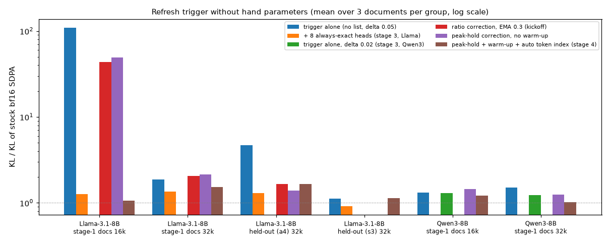
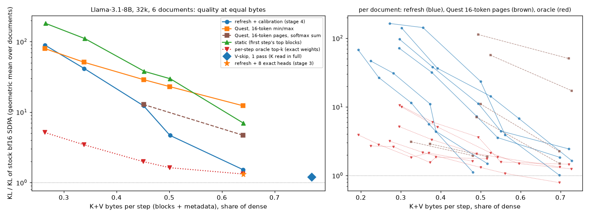
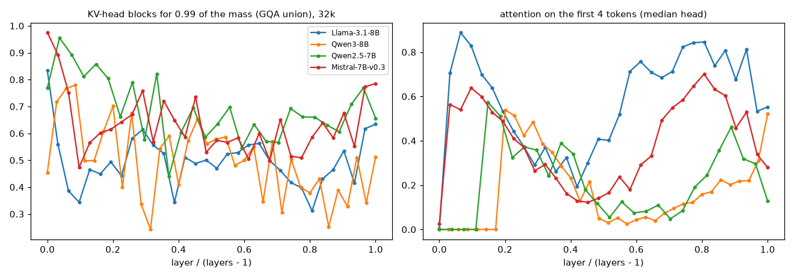
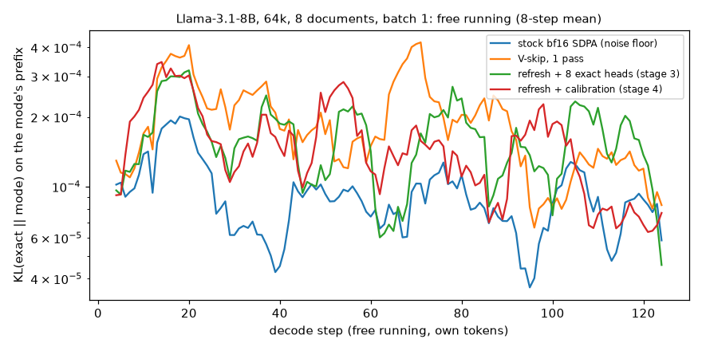

# kvskip — дайджест этапа 4: закрыть дыры и подготовить к публикации

*15 окт 2026 · Llama-3.1-8B-Instruct, Qwen3-8B, Qwen2.5-7B-Instruct, Mistral-7B-Instruct-v0.3 (bf16) · RTX 4090 · kickoff: `docs/04-tails.md`*

## TL;DR

- **Один механизм вместо списка голов и подбора δ — да, при тех же байтах.** Голова поправляет свою оценку потерянной массы убывающим максимумом того, что показали её refresh-шаги. Короткий разогрев собирает первые выборки, голова с большой поправкой подключает индекс по токену.
  - Llama: при 16k ×1.06 (со списком ×1.27, без ничего ×109). При 32k ×1.54–1.65 против ×1.30–1.35 у списка; остаток почти весь на коде — одна голова промахивается раз за документ.
  - Qwen3: ×1.21 / ×1.03 (16k / 32k) против ×1.30 / ×1.24 у δ = 0.02, при меньших байтах.
  - Qwen2.5: ×1.03 без какой-либо настройки.
- **Гипотеза kickoff (поправка-отношение) не сработала, поправка по среднему — тоже.** У (2, 5) оценка в порядке на большинстве шагов и катастрофически неверна на редких: мимо уходит 40–94% массы. Важен хвост ошибки, а не её среднее.
- **1.2:** правило «слой 0 плотный» остаётся — Llama без него хуже, Qwen3 всё равно.
- **1.3:** калибровка находит те же головы, что и офлайн-диагностика: (2, 5) у Llama; у Qwen3 индукционную (13, 3) и головы-дубликаты — 5 из 8 голов офлайн-калибровки этапа 3. Индекс по поправке включать можно.
- **При равных байтах refresh-политика — лучший реализуемый метод на своей рабочей точке:** ×1.53 при 64% байт против Quest ×4.7–22 (в зависимости от варианта) и static ×7.0.
  - Оракул — выбор лучших блоков по точным весам на каждом шаге — даёт ×1.32. Ручная политика этапа 3 — столько же.
  - Ниже рабочей точки политика деградирует быстрее выбора на каждом шаге и на 30% байт лишь догоняет Quest.
- **Qwen2.5 опровергает «QK-norm убирает sink»:** QK-norm у неё нет, а sink такой же слабый, как у Qwen3. Mistral (тоже без QK-norm) держит sink, как Llama. Слабый sink — свойство семьи Qwen.
  - Доля блоков для 0.99 массы — не общая константа: 29–39% на query-голову, 49–69% на KV-голову при 32k у четырёх моделей.
  - Длинный хвост и прыжки — у всех. Калиброванный триггер работает на всех четырёх без настройки: ×1.03–1.54.
- **Свободная генерация на 64k не расходится** (8 документов, bs = 1, каждый режим на своих токенах).
  - KL к эталону на собственных префиксах: ×1.79 к шуму стокового SDPA, который тоже генерирует свободно. Ровно все 128 шагов, без накопления.
  - Жадный выбор совпадает с эталоном на том же префиксе в 99.4% шагов.
  - Где текст отходит от текста эталона (4 документа из 8), это пересказ: «has crept» → «had crept».
- **Gate с калибровкой** (послойная лаборатория, 8 документов): шаг decode −18 / −27% (bs 8 / 32, 32k) и −26 / −34% (64k) — столько же, сколько у ручной политики этапа 3, без списка голов. KL ×1.25 / ×1.38 против ×1.41 / ×1.32.
- **Репозиторий готов для внешнего читателя:** README в новом порядке, `docs/` переименованы, по скрипту воспроизведения на этап, лицензия, пины, скелет поста.

## 1. Что сделано

| фаза | что | где |
|---|---|---|
| 1.1 | онлайн-калибровка оценки потерянной массы: поправка-отношение (kickoff), аддитивная EMA, убывающий максимум; разогрев; в probe, в Python-планировщике и в CUDA-ядрах `plan` / `update`; тест ядер против Python-версии | `src/reuse.py`, `src/kvskip_attn.py`, `kernels/kvskip_planner.cu`, `bench/test_planner.py` |
| 1.2 | правило «плотный слой»: без плотных слоёв и с плотными 1–3 (Qwen3) | `src/run_reuse.py` (опция `dl=`) |
| 1.3 | автоиндекс: голова с большой поправкой подключает индекс по токену; какие головы калибровка выделяет | `src/reuse.py`, ядра (`aix`), `src/analyze_stage4.py` |
| 2.1–2.3 | при равных байтах (с метаданными): Quest в пяти вариантах, static, оракул, V-skip в 1 проход; кривые по уровню top-p | `src/reuse.py` (`quest` / `static` / `topk`), `src/run_reuse.py` (`match=`) |
| 3.1 | Qwen2.5-7B-Instruct: карта слоёв, sink, доля блоков, прыжки, триггер с калибровкой и без | `src/run_collect.py`, `src/run_reuse.py` |
| 3.2 | Mistral-7B-Instruct-v0.3: то же для карты (Gemma 3 закрыта лицензией) | там же |
| 4 | свободная генерация на 64k: 8 документов, bs = 1, KL к эталону на собственных префиксах | `src/run_free.py` |
| — | калиброванная политика в точках gate (лаборатория, bs 1 / 8 / 32 × 32k / 64k) | `src/lab.py` (условие `refresh_cal`) |
| 5 | README для внешнего читателя, переименование `docs/`, `reproduce/`, лицензия, пины, docstring'и, скелет поста | корень репо, `docs/post-draft.md` |

## 2. Фаза 1 — один механизм вместо δ и списка голов

### 2.1 Гипотеза kickoff (поправка-отношение) не сработала

Сделано по kickoff: на каждом refresh-шаге голова читает все блоки и знает реальную потерянную массу своего старого набора. Рядом лежит оценка, по которой она принимала решение. На KV-голову хранится EMA разности `logit(реальная) − logit(оценка)` (для малых долей это логарифм отношения). Решение принимается по `sigmoid(logit(оценка) + c) > δ`, δ = 0.05.

Варианты: α ∈ {0.1, 0.3}, холодный старт «без поправки первые 32 шага» и «refresh раз в 8 шагов первые 32 шага», поправка только вверх или в обе стороны.

| Llama-3.1-8B, KL × шум, среднее (худший документ) | 16k, 3 док. | 32k, 3 док. | 32k held-out, 3 док. |
|---|---|---|---|
| триггер без списка | 109 (319) | 1.87 (2.6) | 4.69 (11.1) |
| + 8 точных голов (этап 3) | 1.27 (1.7) | 1.35 (1.5) | 1.30 (1.5) |
| поправка-отношение, EMA 0.3 (kickoff) | 44 (125) | 2.05 (2.8) | 1.66 (2.2) |
| то же + refresh раз в 8 шагов первые 32 | 11.6 (32) | 1.41 (1.6) | 1.50 (1.9) |

**Почему.** Голова (2, 5), главный источник «невидимых» потерь у Llama, не занижает оценку систематически.

- На большинстве refresh-шагов её реальный промах 1–10%: оценка в порядке.
- Беда — редкие одиночные шаги, на которых голова уходит на один далёкий токен и старый набор теряет 40–94% её массы. В прозе при 16k 59 из 62 голово-шагов с покрытием < 0.8 приходятся на (2, 5), в диалоге 19 из 21.
- Это индукционные события: на этих шагах индекс по токену покрывает 84–99% массы головы, на «токен после прошлого вхождения» приходится 25–63%.
- Поправка по среднему (отношение или разность) видит такой шаг, только если на него пришёлся refresh. Увидев, она поднимается и за несколько шагов забывает. Чтобы отношение довело оценку 0.5% до порога 5%, нужен множитель ×10 и больше. За 128 шагов EMA до него не дорастает: у (2, 5) поправка доходит до 1.2–1.3 в логитах (×3.5).

**Побочный эффект холодного старта.** Refresh в «узкий» момент строит узкий набор, и оценка слепа к тому, что потом возвращается. В прозе при 16k вариант с частыми refresh в начале дал ×32 против ×5 без них. В диалоге — наоборот, ×1.57 против ×125. Результат зависит от того, когда случился refresh.

### 2.2 Что сработало: убывающий максимум + разогрев + автоиндекс

Три изменения против kickoff:

1. **Поправка — не среднее, а убывающий максимум.** На refresh-шаге `c = max(0.95·c, реальная − оценка)`, решение — по `оценка + c > δ`. Поправка убывает на 5% за выборку: промах в 0.9 держит её выше δ ещё ~55 выборок, и всё это время голова делает refresh на каждом шаге, т.е. выборки идут подряд. Если промахи повторяются, голова фактически становится точной сама.
2. **Разогрев.** Первые 32 шага каждая голова делает refresh не реже чем раз в 8 шагов, чтобы быстрее набрать выборки. Без разогрева убывающий максимум не работает: первый промах приходит раньше первой выборки (×49 при 16k).
3. **Автоиндекс.** Голова с `c > 0.1` навсегда (в пределах последовательности) подключает индекс по токену: блоки с прошлыми вхождениями текущего токена и токенами после них входят в её набор, без чтения K.

Слой 0 остаётся плотным (§2.3). δ = 0.05 и максимальный возраст 32 — те же, что раньше, для обеих моделей.

KL × шум, среднее по 3 документам (худший документ); held-out (a4) — prose2 / code2 / dialog2 этапа 2, новые (s3) — prose3 / code3 / dialog3 этапа 3:

| вариант | Llama 16k | Llama 32k | Llama 32k held-out | Llama 32k новые | Qwen3 16k | Qwen3 32k |
|---|---|---|---|---|---|---|
| триггер без списка (δ = 0.05) | 109 (319) | 1.87 (2.6) | 4.69 (11.1) | 1.13 (1.3) | 1.31 (1.5) | 1.52 (2.2) |
| + 8 точных голов (этап 3, Llama) | 1.27 (1.7) | 1.35 (1.5) | 1.30 (1.5) | 0.92 (1.1) | — | — |
| δ = 0.02 (этап 3, Qwen3) | — | — | — | — | 1.30 (1.9) | 1.24 (1.6) |
| поправка-отношение (kickoff) | 44 (125) | 2.05 (2.8) | 1.66 (2.2) | — | — | — |
| аддитивная EMA + разогрев | 2.36 (3.7) | 1.36 (1.8) | 1.56 (1.9) | — | 1.26 (1.7) | 1.28 (1.6) |
| убывающий максимум, без разогрева | 49 (121) | 2.13 (3.0) | 1.39 (1.5) | — | 1.45 (1.8) | 1.25 (1.7) |
| убывающий максимум + разогрев | 1.07 (1.5) | 1.63 (2.3) | 1.63 (2.4) | 1.19 (1.2) | 1.47 (1.6) | 1.28 (1.4) |
| **+ автоиндекс (этап 4)** | **1.06 (1.5)** | **1.54 (1.8)** | **1.65 (2.4)** | **1.14 (1.2)** | **1.21 (1.3)** | **1.03 (1.1)** |
| байт K+V: этап 4 / ручные параметры | 74% / 74% | 64% / 64% | 65% / 64% | 63% / 63% | 73% / 76% | 69% / 72% |
| refresh, голово-шагов: этап 4 / ручные | 8.4% / 7.6% | 9.3% / 7.9% | 8.9% / 7.8% | 8.7% / 7.7% | 17% / 22% | 21% / 26% |

- **Llama.** Катастрофы ушли: при 16k ×1.06 против ×109 без списка и ×1.27 со списком, при тех же байтах.
  - При 32k небольшой остаток: ×1.54 и ×1.65 против ×1.35 и ×1.30 у списка, почти весь — код.
  - На коде при 32k один шаг 62 головы (5, 2), которая до этого ни разу не промахнулась на refresh (поправка 0.003), теряет 31% её массы и даёт ×92 к шуму. Среднее по документу ×1.84, без трёх худших шагов ×0.95.
  - Такую голову, у которой промах случается раз за документ, никакой детектор по выборкам не увидит до первого промаха. Список голов знает её по другим документам.
- **Qwen3.** Калибровка заменяет порог δ = 0.02: ×1.21 / ×1.03 (16k / 32k) против ×1.30 / ×1.24, при меньших байтах (69% против 72% при 32k).
  - Диалог при 32k: ×2.23 → ×1.06; с δ = 0.02 было ×1.64.
- **На трёх новых документах** (Gutenberg #77959, `scheduler.py` torch 2.14, UltraChat seed 2; 32k): ×1.14 против ×0.92 со списком и ×1.13 у одного триггера — всё в пределах шума.
  - Более длинный разогрев (64 шага, refresh раз в 4) даёт ×1.07 ценой +2.6 п.п. байт.
- **Среднее KL держится на хвосте.** Без двух худших шагов из 128 при 32k: ×1.06 у калибровки против ×0.90 у списка; при 16k ×0.85 против ×0.86.

### 2.3 Нужно ли правило «плотный слой» (1.2)

С калибровкой, без автоиндекса, KL × шум:

| | Llama 16k | Llama 32k | Llama 32k held-out | Qwen3 16k | Qwen3 32k |
|---|---|---|---|---|---|
| слой 0 плотный (как было) | 1.07 | 1.63 | 1.63 | 1.47 | 1.28 |
| без плотных слоёв | 1.76 | 1.71 | 1.76 | 1.59 | 1.18 |
| плотные 1–3 (карта слоёв Qwen3) | — | — | — | 1.31 | 1.39 |

- **У Llama правило нужно:** без него KL хуже во всех трёх наборах (×1.6 при 16k), а экономия — 0.1–0.5 п.п. байт. Слой 0 у Llama и так читает 83% блоков.
- **У Qwen3 правило ни на что не влияет:** все три варианта в пределах шума, плотные 1–3 тоже ничего не дают.
- **Решение:** правило «слой 0 плотный» остаётся — дёшево и защищает Llama.

### 2.4 Индукционные головы через калибровку (1.3)

Какие головы калибровка выделяет и подключает к индексу:

- **Llama.** Во всех 9 документах к индексу подключается (2, 5) — самая сильная индукционная голова.
  - Остальные головы с большой поправкой — содержательные головы слоёв 11–16, той полосы, где случаются прыжки. Они не индукционные.
  - С топ-8 по индукционной диагностике совпадают 2 головы, Spearman 0.56.
- **Qwen3.** Во всех 6 документах подключаются (13, 3) — индукционная, (7, 1) и (9, 7) — головы-дубликаты (масса на прошлых вхождениях *того же* токена 7–12%). Затем (9, 2) и (11, 2).
  - Пять из этих голов входят в список, который этап 3 получил офлайн-калибровкой (`dh=7.1,13.3,9.2,21.2,9.7,30.1,11.2,19.6`).
- **Ответ на 1.3: да, индекс можно включать по поправке.** Онлайн-калибровка находит те же головы, что и диагностика.
  - На Qwen3 индекс убирает остаток потерь: ×1.28 → ×1.03 при 32k.
  - На Llama он нейтрален: её главную голову калибровка и так делает точной, а это 0.4% байт.
  - Индукционная диагностика «масса после вхождения» одна не находит головы-дубликаты; индекс по токену покрывает оба вида.

## 3. Фаза 2 — сравнение с существующим на равном бюджете

### 3.1 Как сравнивали

- **Модель и данные:** Llama-3.1-8B, 32k, 6 документов (3 этапа 1 + 3 held-out), 128 шагов decode на токенах эталона. KL против fp32-эталона в долях шума стокового SDPA.
- **Бюджет — суммарные байты K+V за 128 шагов вместе с метаданными каждого метода**, по всем слоям (слой 0 плотный у всех):
  - у refresh-политики — суммы ключей блоков в fp32, ссылки и статистика планировщика: 2.0% от K+V слоя (в bf16 было бы 1.2%);
  - у Quest — min/max ключей в bf16 на подблок: 1/16 от K+V при подблоках по 16 токенов, 1/64 при 64;
  - у static и оракула — ноль.
- **Совпадение байт.** Для каждого документа сначала идёт refresh-политика. Остальные методы получают ровно столько же байт на этом же документе, равномерно по шагам и KV-головам.
- **Методы:**
  - **Quest** — верхняя граница `Σ_d max(q_d·min_d, q_d·max_d)` по подблокам. Вариант kickoff: подблоки 16, загрузка блоками по 64. Плюс собственная гранулярность Quest — страницы по 16 токенов — и четыре способа объединить 4 query-головы GQA-группы (нормированный максимум, сырой максимум, сумма softmax, round robin);
  - **static (как SnapKV/H2O)** — лучшие блоки внимания первого шага, без обновления;
  - **оракул** — лучшие блоки по точным весам на каждом шаге (нереализуем: нужен весь K);
  - **V-skip в 1 проход** — читает весь K, это отдельная строка, байты свои.
- **Бюджеты ниже рабочей точки.** У refresh-политики единственный способ читать меньше — понизить уровень top-p набора. При δ = 0.05 это не работает: набор уровня 0.95 по построению теряет ~5%, и триггер срабатывал на 70–94% голово-шагов (§8). Порог сдвинут с уровнем: δ = 1.04 − p, т.е. refresh, когда оценка превышает то, что набор и так не покрывает, на те же 4 п.п. Уровни 0.99 / 0.9 / 0.8 / 0.6 / 0.4.

### 3.2 Рабочая точка: top-p 0.99, 64% байт

KL × шум, среднее геометрическое по 6 документам (худший документ); отношения KL разнятся на порядки, поэтому не арифметическое среднее:

| метод | байт K+V | KL × шум |
|---|---|---|
| refresh + калибровка (этап 4) | 64% | 1.53 (2.4) |
| refresh + 8 точных голов (этап 3) | 64% | 1.32 (1.5) |
| оракул: лучшие блоки по точным весам каждый шаг | 64% | 1.32 (1.8) |
| Quest, страницы по 16 токенов, сумма softmax по группе (лучший вариант) | 64% | 4.7 (51) |
| Quest, подблоки 16, загрузка по 64 (вариант kickoff) | 64% | 12.3 (84) |
| Quest, блоки по 64 | 64% | 21.8 (151) |
| static: лучшие блоки первого шага | 64% | 7.0 (28) |
| V-skip в 1 проход (весь K) | 77% | 1.19 (1.8) |

- **Refresh-политика — лучший реализуемый метод на своих байтах.** Ручная версия этапа 3 и вовсе на уровне оракула: выбор раз в несколько шагов почти не уступает выбору на каждом шаге, если refresh приходится на прыжки.
- **Quest сильно зависит от документа.** Лучший его вариант на одном коде даёт ×1.49 (у нас ×1.84), на диалогах ×1.9–2.0 (у нас ×1.1–1.5), но на прозе ×17 и на втором коде ×51.
  - Собственная гранулярность Quest (страницы по 16) — главное улучшение: ×12 → ×5.4 в среднем.
  - Способ объединения головок группы почти не важен: ×9.8–12.3.
  - Вероятная причина — оценка min/max по каналам для ключей Llama слишком свободна: блок с одним большим каналом получает высокую оценку при малом реальном весе. Это наша интерпретация, её не проверяли.
- **Static даёт ×2.1–28 против ×1.0–2.4 у refresh-политики:** прыжки ломают его так же, как таймер, это иллюстрация факта 2. На диалогах он ближе всего (×2.1–2.5): модель отвечает про одну беседу, и её блоки выбраны на первом шаге.
- **V-skip в 1 проход — практичный вывод для многих:** ×1.19 без состояния и без калибровки, но 77% байт — K читается целиком.

### 3.3 Ниже рабочей точки

KL × шум при фиксированной доле байт (интерполяция по кривой каждого документа, среднее геометрическое):

| байт K+V | refresh + калибровка | Quest-16 (kickoff) | static | оракул | документов |
|---|---|---|---|---|---|
| 60% | 3.7 | 50 | 53 | 1.4 | 4 |
| 50% | 8.5 | 37 | 60 | 2.1 | 5 |
| 40% | 17.6 | 35 | 79 | 2.9 | 6 |
| 30% | 61 | 59 | 145 | 4.4 | 6 |

- **Refresh-политика выигрывает у Quest и static до 40% байт; на 30% она догоняет Quest и хуже оракула в 14 раз.**
- **Она — метод рабочей точки.** Узкий набор, выбранный по низкому уровню, за следующие шаги устаревает сильнее, чем широкий, а порог δ = 1.04 − p разрешает голове терять до (1 − p) + 4% массы между refresh.
- **Оракул показывает, что запас есть:** при 40% байт выбор на каждом шаге даёт ×2.9. Разрыв — цена выбора без чтения K.

## 4. Фаза 3 — третья и четвёртая модели: Qwen2.5-7B, Mistral-7B

- **Qwen2.5-7B-Instruct** — та же семья, что Qwen3, но без QK-norm. 28 слоёв, 28 query- и 4 KV-головы (группа GQA из 7), d = 128, родное окно 32k.
- **Mistral-7B-Instruct-v0.3 (пункт 3.2)** — другая семья без QK-norm, геометрия как у Llama: 32 слоя, группа из 4, без скользящего окна. Gemma 3 с её локальными и глобальными слоями была бы интереснее, но закрыта лицензией для этого аккаунта.

Те же 3 документа × 16k / 32k, те же прогоны: collect для карты, diag для прыжков и триггера.

### 4.1 Одна таблица на четыре модели (32k)

| | Llama-3.1-8B | Qwen3-8B | Qwen2.5-7B | Mistral-7B |
|---|---|---|---|---|
| QK-norm / группа GQA | нет / 4 | есть / 4 | нет / 7 | нет / 4 |
| блоков на 0.99 массы, query-голова (слои > 0) | 29% | 29% | 35% | 39% |
| блоков на 0.99 массы, KV-голова (union группы) | 49% | 50% | 69% | 62% |
| слой 0: блоков KV-голове | 83% | 45% | 77% | 97% |
| самые плотные слои | 0, 30, 31 | 1–3 | 1, 2, 4 | 0, 1, 31 |
| масса на первых 4 токенах, медиана по слоям | 0.66 | 0.13 | 0.19 | 0.39 |
| слои без sink (медиана < 0.01) | 1 (слой 0) | 7 (0–6) | 4 (0–3) | 0 |
| масса на блоке 0 / на 2 последних блоках | 55% / 25% | 21% / 35% | 26% / 41% | 45% / 26% |
| прыжки: KV-голов, впервые теряющих покрытие за шаг, максимум (медиана) | 99 из 248 (9) | 83 из 280 (14.5) | 35 из 108 (4) | 48 из 248 (3) |
| таймер N = 32: KL × шум, среднее (худший) | 10.4 (21) | 14.8 (28) | 12.5 (25) | 2.0 (2.4) |
| триггер без калибровки: KL × шум / байт | 1.87 / 63% | 1.52 / 66% | 0.88 / 82% | 1.26 / 74% |
| триггер с калибровкой (этап 4): KL × шум / байт | 1.54 / 64% | 1.03 / 69% | 1.03 / 83% | 1.28 / 74% |

Прыжки считаются при наборе таймера N = 32, как в этапе 3. У Qwen3 тут 83 головы вместо 86 из этапа 3: учитываются только шаги, на которых и этот, и предыдущий наборы уже устарели.

### 4.2 Ответы на вопросы kickoff

- **Sink вернулся? Нет — гипотеза «QK-norm убирает sink» не подтверждается.** У Qwen2.5 QK-norm нет, а sink такой же слабый, как у Qwen3: медиана 0.19 против 0.13.
  - Профиль по слоям тот же: у Qwen2.5 в слоях 0–3 на первых токенах ничего, на слое 4 — 0.57, в середине 0.05–0.1, к концу снова 0.3–0.46. У Qwen3: слои 0–6 по нулям, слой 7 — 0.54, середина 0.02–0.1.
  - Mistral без QK-norm держит sink, как Llama, со слоя 1 (медиана 0.39). Две семьи — два профиля.
  - Слабый sink — свойство семьи Qwen (обучения, данных или чего-то ещё в архитектуре), а не QK-norm.
- **Доля блоков снова ~50%? Нет, это не общая константа.** На query-голову 29 / 29 / 35 / 39%, на KV-голову 49 / 50 / 69 / 62%.
  - Совпадение Llama и Qwen3 в этапе 3 (49% и 50%) было совпадением двух моделей.
  - Группа из 7 у Qwen2.5 добавляет к union, но и Mistral с группой из 4 читает 62%.
  - Общее у всех четырёх — длинный хвост: на 99% массы query-голове нужна треть контекста.
- **Прыжки есть у всех:** до 19–40% KV-голов разом.
  - Таймер ломается у трёх моделей (×10–15 в среднем). У Mistral при 32k мягче (×2.0), при 16k на прозе — ×400.
- **Триггер с калибровкой работает без настройки на всех четырёх:** ×1.03–1.54. Без калибровки он уже хорош у Qwen2.5 (×0.88) и Mistral (×1.26) — у них нет головы, чьи промахи оценка не видит. Калибровка там ничего не портит и стоит 0–0.5 п.п. байт.
- **Байты следуют за долей блоков:** Qwen2.5 и Mistral при той же политике читают 74–83% против 64–69%.

## 5. Фаза 4 — свободная генерация на 64k

### 5.1 Почему не в лаборатории

Kickoff просил прогон bs = 8/64k в послойной лаборатории со своими токенами режима. Лаборатория так не умеет: она проводит позицию decode через модель по одному слою, и токен шага t + 1 неизвестен, пока слой 0 шага t не пройден. Свободной генерации нужен порядок по шагам, т.е. весь KV последовательности на карте.

- При 64k у Llama-3.1-8B это 8 ГиБ на последовательность, рядом с 13 ГиБ слоёв декодера.
- Влезает при bs = 1, если таблица эмбеддингов и lm_head (по 1 ГиБ) живут на CPU, а prefill идёт через FA2: путь SDPA в HF при маске размножает K/V в 4 раза, это ещё 1 ГиБ.
- Те же 8 документов точки gate идут по одному. Ядра и планировщик обрабатывают элементы батча независимо, от батча зависит только число сплитов — порядок суммирования в fp32.

### 5.2 Протокол

Каждый режим генерирует 128 шагов жадно на своих токенах. Затем fp32-эталон проходит те же токены с учительским принуждением и даёт распределение эталона на префиксах режима. Отсюда KL на каждом шаге и совпадение жадного выбора с эталоном на том же префиксе. Шум — стоковый SDPA, генерирующий так же свободно. Свой текст эталона — его собственная свободная генерация.

### 5.3 Результат: не расходится

| режим | KL × шум, среднее (худший документ) | жадный выбор = эталона на том же префиксе | текст совпадает с текстом эталона | повторы 8-грамм |
|---|---|---|---|---|
| стоковый SDPA (шум) | 1.00 | 99.7% | 6 из 8 | 0.1% |
| V-skip в 1 проход | 2.40 (5.4) | 99.3% | 5 из 8 | 0.1% |
| refresh + 8 точных голов (этап 3) | 1.81 (3.0) | 99.9% | 7 из 8 | 0.1% |
| **refresh + калибровка (этап 4)** | **1.79 (3.6)** | **99.4%** | **4 из 8** | **0.1%** |

Повторы те же, что у эталона: у одного диалога 0.8%, у остальных ноль. Refresh-политика читает 55% блоков K+V на разреженных слоях при 64k.

- **Ошибка не накапливается.** KL на шаг держится в одной полосе (0.6–4 · 10⁻⁴) все 128 шагов, без роста к концу. У разреженных режимов она примерно вдвое выше, чем у SDPA, — как при учительских токенах.
- **Где тексты расходятся — пересказ, а не ошибка.** Тексты калиброванной политики отходят от текста эталона в 4 документах из 8, на шагах 17–55; у стокового SDPA — в 2 документах, на шагах 24–25. Примеры:
  - проза: «has crept over the city» → «had crept over the city», дальше слово в слово;
  - проза: два предложения о детстве рассказчика слиты в одно, факты те же, плюс верная деталь из текста про дядю («indulgent but impecunious»);
  - диалог: «uses for various tree species» → «traditions when it comes to trees», дальше тот же список деревьев.
- **Последнее возражение к «качество то же» закрыто для 128 шагов на 64k:** свободная генерация ведёт себя как стоковый bf16-кернел, только с удвоенным шумом. Длинные генерации (тысячи токенов) не проверялись; перплексия на 2k токенов при 32k (этап 2) — ближайшая проверка такого рода.

## 6. Точки gate с калибровкой

Та же послойная лаборатория, что в этапе 3 (8 документов ≥ 70k токенов, 128 шагов на учительских токенах), политика этапа 4 в CUDA-ядрах (условие `refresh_cal`). Мс на шаг decode всей модели (HF eager) и изменение против kvskip dense того же прогона:

| режим | 32k, bs=1 | 32k, bs=8 | 32k, bs=32 | 64k, bs=1 | 64k, bs=8 | 64k, bs=32 | KL × шум 32k / 64k |
|---|---|---|---|---|---|---|---|
| стоковый SDPA | 24.5 | 58.3 | 174.6 | 29.4 | 95.9 | 326.7 | 1.00 / 1.00 |
| kvskip dense | 24.2 | 57.9 | 172.5 | 28.8 | 95.5 | 322.8 | 1.08 / 1.08 |
| V-skip в 1 проход | 26.3 | 49.3 (−15%) | 137.6 (−20%) | 26.7 | 72.1 (−25%) | 228.7 (−29%) | 1.19 / 1.38 |
| refresh + 8 точных голов (этап 3) | 29.1 | 47.2 (−19%) | 125.5 (−27%) | 29.3 | 69.2 (−28%) | 210.4 (−35%) | 1.41 / 1.32 |
| **refresh + калибровка (этап 4)** | **30.2** | **47.5 (−18%)** | **125.9 (−27%)** | **30.4** | **70.2 (−26%)** | **213.3 (−34%)** | **1.25 / 1.38** |

- **Скорость та же, что у ручной политики, в пределах пункта:** калибровка добавляет refresh (9.9% / 10.8% голово-шагов против 8.7% / 8.8%), но убирает 8 всегда точных голов. Прочитано 61% / 55.5% блоков разреженных слоёв.
- **Время attention следует за байтами:** −32…−37% при чтении 57–62% K+V шага (со слоем 0).
- **На bs = 1 выигрыша по-прежнему нет:** 30.2 мс против 24.2 мс — три запуска на слой, HF eager и Python вокруг. Здесь нужен CUDA graph, а не другой пропуск.

## 7. Фаза 5 — репозиторий и текст

- **README переписан для внешнего читателя:** три факта → механизм → числа → ограничения → установка и воспроизведение.
  - Третий факт kickoff предлагал уточнить как «тело — архитектура, хвост — общий». Данные четырёх моделей уточнили его иначе: «тело зависит от семьи моделей, длинный хвост — у всех» (§4). QK-norm sink не убирает, а доля блоков на 0.99 массы — не общая константа.
  - В числах байты и время attention отделены от времени шага; время шага помечено «HF eager».
  - Таблица сравнения с Quest / static / V-skip при равных байтах — в README.
- **`docs/` переименованы единообразно:** `01-decode-sparsity`, `02-kernel` (было `02-core`), `03-gate` (было `03-win`), `04-tails`. Kickoff'ы и дайджесты сохранены, ссылки внутри обновлены; история файлов в git не потеряна.
- **Воспроизведение:** `reproduce/NN-*.sh` — по скрипту на этап, у каждой команды время и пиковая память GPU; `./reproduce.sh N` запускает этап.
- **Окружение:** `requirements.txt` и `pyproject.toml` с пинами (torch 2.14.1+cu126, transformers 5.19.0, triton 3.8.0 и остальное), сборка FA2 под C++20 — в README.
- **Лицензия:** MIT. Это мой выбор по умолчанию — замени, если нужна другая.
- **Код:** у каждого `src/*.py` в docstring — что считает и откуда вход (строка `Input:`). Два устаревших места поправлены, без рефакторинга.
- **`docs/post-draft.md`** — скелет поста по семи разделам kickoff, с ключевыми утверждениями и списком картинок.

## 8. Что сломалось и как чинилось

1. **Гипотеза kickoff не подтвердилась.** Поправка-отношение (EMA логарифма отношения) не делает (2, 5) точной сама: промахи этой головы редкие и одиночные, а не систематические (§2.1). Две следующие попытки — аддитивная EMA, затем убывающий максимум без разогрева — провалились по той же причине. Сработал убывающий максимум с разогревом.
2. **Разогрев с поправкой-отношением в прозе при 16k дал ×32 вместо ×5:** refresh в «узкий» момент строит узкий набор. С убывающим максимумом это ушло: голова, раз промахнувшаяся, становится точной.
3. **Редкие нарушители остаются:** (5, 2) на коде при 32k промахивается один раз за документ, и этот шаг даёт ×92. Детектор по выборкам не увидит голову до первого промаха.
4. **Низкие уровни top-p с δ = 0.05 «взорвались».** Набор на уровне 0.95 по построению теряет ~5%, и триггер срабатывал на 70–94% голово-шагов. Первый прогон сравнения при равных байтах остановлен на первом документе. Порог связан с уровнем: δ = 1.04 − p, т.е. refresh, когда оценка превышает то, что набор и так не покрывает, на те же 4 п.п.
5. **Quest оказался в разы хуже, чем обещало ранжирование этапа 2.** Там Quest-16 собирал 0.99 массы с ×1.3 блоков оракула, здесь при равных байтах вариант kickoff дал ×12 к шуму в среднем.
   - Проверили реализацию оценки построчно и добавили варианты: 4 способа объединить головы группы и собственные страницы Quest по 16 токенов. Лучший вариант — ×4.7 в среднем, по документам ×1.5–51.
   - Ранжирование «в среднем» (этап 2) не говорит о хвосте: Quest нечасто, но сильно промахивается, а KL держится на худших шагах.
6. **Послойная лаборатория не умеет свободную генерацию:** токен шага t + 1 неизвестен, пока слой 0 шага t не прошёл. Свободная генерация сделана в настоящей модели при bs = 1 на документ, со сдвигом эмбеддинга и lm_head на CPU, чтобы 8 ГиБ KV при 64k влезли рядом с весами (§5).
7. **Тест планировщика сначала не проверял автоиндекс:** при пороге 0.02 ни одна голова не подключалась. Порог в тесте снижен до 0.001 — подключаются 20 голов, решения совпадают на 100%.
8. **Mistral упал на первом шаге:** в его `generation_config` EOS — одно число, а не список. Добавлен `common.eos_ids`, прогон повторён.
9. **Gemma 3 закрыта лицензией** (403 для этого аккаунта), поэтому для «другой геометрии» взят Mistral.

## 9. Что дальше

1. **Пост.** Цель этапа — пост и репозиторий как приложение к нему. Скелет с утверждениями, числами и списком картинок — в `docs/post-draft.md`.
2. **Редкие нарушители.** Остаток на Llama — головы, которые промахиваются раз за документ, например (5, 2) на коде. Калибровка учится на одной последовательности и начинает с нуля.
   - Головы — свойство модели, а не документа: (2, 5) находится во всех 9 документах.
   - Состояние калибровки, переносимое между запросами (поправка на голову, медленно убывающая), закроет этот остаток без ручного списка: это тот же список, но выученный на трафике.
3. **Малые бюджеты.** Refresh-политика — метод рабочей точки (top-p 0.99, 48–73% байт). Опускать её уровень вниз бессмысленно: устаревшие узкие наборы теряют больше, чем выбор на каждом шаге.
   - Ниже ~40% байт нужен другой выбор — например, сохранённый набор плюс страницы Quest по 16 токенов для хвоста.
4. **Движок** (paged KV, CUDA graphs, слитые ядра вне attention) — отдельный проект после поста, как и решено в kickoff.
5. **Gemma 3** (QK-norm, локальные и глобальные слои) — модель с QK-norm из третьей семьи. Если у неё sink есть, связь «QK-norm — нет sink» окончательно отпадёт, а локальные слои дадут другую карту. Модель на Hugging Face закрыта лицензией: нужно принять её в аккаунте, после этого — один collect.
6. Доводка ядра (CUDA graph для bs = 1, сплиты по фактическим спискам, блок 32) — как и было, по остаточному принципу.

## 10. Как воспроизвести

`reproduce/04-tails.sh` (все команды этапа со временем и памятью); `./reproduce.sh 4` запускает его целиком, ~5 ч на RTX 4090. Сырые данные — `results/{reuse,collect,free,lab}`, таблицы — `results/tables/stage4_*`, графики — `results/figures/stage4_*`.
