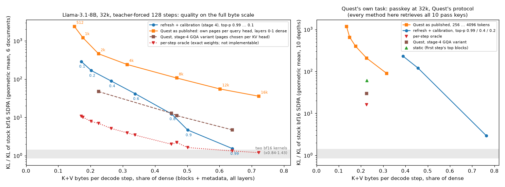
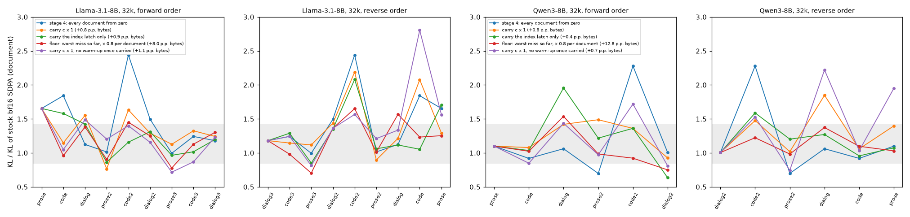

# kvskip — дайджест этапа 5: Quest в его режиме, калибровка между запросами

*15 окт 2026 · Llama-3.1-8B-Instruct, Qwen3-8B (bf16) · RTX 4090 · kickoff: `docs/05-quest.md`*

## TL;DR

**Фаза 1 — Quest в собственном режиме**

- **Наш Quest — это опубликованный Quest.** На реальных q/k шага decode наш выбор страниц совпадает с кодом оценки из репозитория Quest бит в бит. Проверено на 3 документах, слоях 9 / 21 / 31, 4 шагах и 7 бюджетах: 0 расхождений из 2.3 млн решений «брать страницу или нет» на бюджет.
- **В своём режиме Quest работает как заявлено.** Passkey по протоколу Quest, 32k, 10 глубин: 10 из 10 при 256–4096 токенах на query-голову, как в статье.
  - Но 10 из 10 и у всех остальных при тех же байтах: у оракула, у static, у нашей политики на нижних уровнях. Passkey методы не различает.
- **Цена малого бюджета видна по KL.** При 2048–4096 токенах выход Quest ×90–210 от шума на passkey и ×240–460 на наших документах, жадный токен совпадает с эталонным на 91–92% шагов.
  - Ниже ~40% байт к bf16 не приближается ничто реализуемое. Даже оракул — лучшие блоки по точным весам на каждом шаге — даёт ×4–8 при 20–30% байт.
- **Бюджет в токенах — не байты.** 2048 токенов на query-голову — это 6% контекста 32k. Но GQA-ядро читает объединение страниц четырёх голов (11%), min/max страниц (1/16 от K+V) и два плотных слоя. Итого 22.5% байт K+V, если считать так же, как мы считаем свои.
- **Опубликованная конфигурация Quest на GQA-модели тратит байты хуже варианта этапа 4.** Этап 4 выбирал страницы на KV-голову; при равных байтах это примерно в 10 раз лучше: ×47 против ×458 при 22.5%, ×4.7 против ~×46 при 64%. Значит, этап 4 сравнивался с более сильным Quest, а не с соломенным. Почти весь разрыв даёт выбор страниц каждой query-головой отдельно (×8), второй плотный слой добавляет ×1.2.
- **Две рабочие точки (1.3).**
  - При 64% байт наша политика в пределах шума (×1.53, оракул ×1.32). Quest в GQA-варианте даёт ×4.7, Quest в конфигурации статьи ~×46.
  - На бюджете Quest наша политика не работает. На passkey она не опускается ниже 39% байт. На документах при 20% байт она даёт ×168 против ×47 у GQA-варианта Quest при 22.5%.
  - Quest сделан, чтобы удержать задачу на малом бюджете, и удерживает. Refresh-политика сделана для точки, где выход неотличим от bf16, и попадает в неё при 64% байт.
- **Хвост нашей политики на passkey — та же индукционная голова (2, 5).**
  - На 3 из 10 глубин один шаг ответа даёт до ×51. На этом шаге (2, 5) теряет 9–14% массы при оценке 0.2%. Её поправка (0.02–0.04) не дошла до порога индекса 0.1.
  - Список этапа 3 на тех же глубинах даёт ×1.0–2.1. (2, 5) на индексе с первого шага — ×0.8–2.5 при тех же байтах.

**Фаза 2 — калибровка между запросами**

- **Ограничение остаётся, но теперь измерено.**
  - Перенос поправки c с затуханием (вариант kickoff) спасает редкого нарушителя (5, 2) на коде в одном порядке из двух: ×1.84 → ×1.15, когда код идёт сразу после прозы, и ×2.08, когда код восьмой.
  - По трассе это не чуткость к промаху: на шаге 62 голова не обновляется ни в одном варианте. Перенесённая поправка сдвинула один refresh с шага 44 на 38, и набор шага 38 случайно содержал нужное на шаге 62.
  - По 16 парам (документ, порядок): ×1.34 против ×1.45 без переноса, +0.8 п.п. байт. Катастрофы при этом переезжают на другие документы. Список этапа 3 на тех же парах даёт ×1.18 без лишних байт.
- **«Пол» из худшего промаха убирает все катастрофы (×1.18), но делает точными ~70 голов из 248.** Это +8 п.п. байт, а критерий kickoff — не больше 1 п.п.
- **Сигнала списка в выборках самой политики нет, поэтому список на трафике не выучивается.**
  - (5, 2) даёт 2 невидимые потери из 132 refresh-выборок за 9 документов — столько же, сколько десяток безвредных голов. Четыре головы списка не дают ни одной.
  - Список этапа 3 собран по наборам, которые живут 32 шага и проверяются на каждом шаге. Политика с триггером видит реальный промах только на своих refresh.
  - Головы с невидимым промахом > 0.1 хоть в одном документе — это 52–65 голов. Из списка в них попадают 4–5.
- **Переносится полезно только защёлка индекса у головы, промахи которой выборки видят.**
  - (2, 5) подключается к индексу во всех 9 документах. Перенесённая на passkey, её защёлка убирает хвост нашей политики: ×14.6 → ×1.5 на трёх глубинах, при тех же байтах.
  - Перенос защёлок на документах: ×1.25 против ×1.45, +0.8 п.п. байт. Но к девятому документу на индексе 56–59 голов, на диалогах это +2.5 п.п.
- **Разогрев остаётся.** Без него при переносе байт больше (+1.2 п.п. против +0.8), а худший провал этапа — ×201 на коде — случился именно в этом варианте.
- **Qwen3: перенос в среднем не помогает** (×1.23–1.36 против ×1.20), на диалогах вредит. Калибровка там и так в шуме, перенесённое состояние только сдвигает refresh.

## 1. Что сделано

| фаза | что | где |
|---|---|---|
| 1.1 | Quest в конфигурации статьи как условие `questp:<токены>`: страницы по 16 токенов, своя выборка у каждой query-головы, слои 0–1 плотные, ничего не добавляется принудительно | `src/reuse.py` (`quest_paper_mask`, `quest_paper`), `src/run_reuse.py` |
| 1.1 | проверка против кода Quest: функции `local_heavy_hitter_mask` и путь decode из `evaluation/quest_attention.py` перенесены дословно и сравнены с нашей выборкой на реальных q/k | `bench/test_quest.py`, `results/bench/quest_reference.md` |
| 1.1–1.2 | passkey по протоколу `evaluation/passkey/passkey.py` из репозитория Quest: 32k, 10 глубин, Quest на 256–4096 токенах, наша политика на трёх уровнях, оракул / static / Quest этапа 4 на байтах Quest-2048 | `src/run_passkey.py` |
| 1.3 | полная шкала байт на 6 документах этапа 4: Quest в конфигурации статьи на 512–16384 токенах, оракул на тех же байтах, наша политика на уровнях 0.2 и 0.1; точки выше 26% — из этапа 4 | `src/run_reuse.py` (сетка `s5q`), `src/analyze_stage5.py` |
| 2.1–2.3 | перенос состояния калибровки между документами: c с затуханием γ (kickoff), только защёлка индекса, «пол» из худшего промаха; без разогрева при переносе | `src/reuse.py` (`carry`), `src/run_carry.py` |
| — | диагностика: какая голова даёт провалы на passkey (с ней и без неё на индексе); разложение Quest по конфигурации; трасса (5, 2) по шагам на цепочке проза → код | `src/run_passkey.py` (`--save-heads`), `src/run_reuse.py` (сетка `s5d`), `src/run_carry.py` (`--trace`) |
| 3 | правки скелета поста | `docs/post-draft.md` |

## 2. Фаза 1 — Quest в собственном режиме

### 2.1 Наш Quest против кода Quest

Возможная ошибка реализации проверена напрямую, без косвенных признаков. В тест перенесён код оценки из репозитория Quest (`evaluation/quest_attention.py`, коммит 54bbfb0): функция выбора `local_heavy_hitter_mask` дословно и путь decode от `repeat_kv` до softmax. Этот код и наш `quest_paper_mask` получают одни и те же q и K (после RoPE, из дампов этапа 2).

| бюджет на query-голову | страниц на query-голову | страниц на KV-голову (объединение 4) | решений, отличных от кода Quest |
|---|---|---|---|
| 256 | 0.8% | 1.5% | 0 из 2.3 млн |
| 1024 | 3.1% | 5.8% | 0 из 2.3 млн |
| 2048 | 6.3% | 11.0% | 0 из 2.3 млн |
| 4096 | 12.6% | 20.4% | 0 из 2.3 млн |
| 16384 | 50.3% | 64.7% | 0 из 2.3 млн |

- **Выбор совпадает полностью** на всех 252 случаях: 3 документа × слои 9 / 21 / 31 × шаги decode 0 / 1 / 16 / 64 × 7 бюджетов от 64 до 16384.
  - Выход attention по выбранным токенам расходится не больше чем на 1e-5. Это округление fp32: Quest маскирует через `finfo.min`, мы через −inf.
- **Оценка — верхняя граница**, как и должна быть: максимум реального скора на странице превышает её не больше чем на 2e-6, то есть на округление.
- Пункты из kickoff, которые надо было проверить первыми:
  - бюджет считается по страницам, а не по блокам: `max(3, tokens // 16)` страниц на голову, как у Quest;
  - оценка — `Σ_d max(q_d·min_d, q_d·max_d)`;
  - плотные слои 0–1, как у Quest.
- **Конфигурация статьи для GQA:** K повторяется на 4 query-головы группы (`repeat_kv`), каждая голова выбирает свои страницы. Ядро, которое читает каждую страницу один раз на KV-голову, читает их объединение. Это 1.5–1.9× от страниц одной головы.

### 2.2 Passkey по протоколу Quest

Протокол — `evaluation/passkey/passkey.py` из репозитория Quest (оттуда же `scripts/passkey.sh`, где Quest сам гоняет Llama-3.1-8B-Instruct):

- строка задачи, наполнитель («The grass is green. …»), строка «The pass key is N. Remember it. N is the pass key.» на глубине d, снова наполнитель, затем «What is the pass key? The pass key is»;
- без шаблона чата;
- всё, кроме последних 400 символов, идёт в prefill плотно. Эти 400 символов (~108 токенов: наполнитель и вопрос) проходят через decode по одному токену, т.е. их читает разреженное внимание;
- затем 10 жадных токенов; первое число ответа сравнивается с N;
- глубины 10, 20, …, 100%; N от 1 до 50000, своё зерно на глубину. Промпт ~32 750 токенов.

KL — на всех шагах decode (вопрос и ответ) на токенах эталона, × шум стокового SDPA; среднее геометрическое по 10 глубинам (худшая глубина в скобках):

| метод | байт K+V | извлечено | KL × шум (худшая глубина) |
|---|---|---|---|
| эталон fp32 | 100% | 10 из 10 | — |
| Quest как в статье, 256 токенов на query-голову | 13.5% | 10 из 10 | 1184 (2915) |
| … 512 | 14.9% | 10 из 10 | 652 (1310) |
| … 1024 | 17.6% | 10 из 10 | 398 (780) |
| … 2048 | 22.5% | 10 из 10 | 208 (660) |
| … 4096 | 31.6% | 10 из 10 | 89 (530) |
| refresh + калибровка (этап 4), уровень 0.99 | 76.4% | 10 из 10 | 2.93 (51) |
| refresh + калибровка, уровень 0.4 | 45.6% | 10 из 10 | 121 (213) |
| refresh + калибровка, уровень 0.2 | 39.0% | 10 из 10 | 230 (596) |
| оракул на байтах Quest-2048 | 22.5% | 10 из 10 | 16.1 (34) |
| static на тех же байтах | 22.6% | 10 из 10 | 60 (352) |
| Quest, вариант этапа 4, на тех же байтах | 22.5% | 10 из 10 | 30 (49) |

- **Quest в конфигурации статьи извлекает все 10 ключей при любом бюджете от 256 токенов.** В статье на 100k при 2048–4096 токенах — 100%; при 32k и тех же бюджетах так же. Реализация в родной точке Quest работает как заявлено.
- **Задача лёгкая для всех.** 10 из 10 у оракула, у static и у варианта Quest этапа 4 на байтах Quest-2048 (22.5%), у нашей политики на уровнях 0.4 и 0.2. Строка с ключом выделяется на фоне повторяющегося наполнителя, и её находит любой выбор с учётом запроса.
  - Static из этапа 4 — не H2O: он берёт лучшие блоки первого шага decode, а это уже 108 токенов до ответа. В статье H2O и TOVA проваливают passkey, потому что вытесняют токены ещё до вопроса.
- **KL различает методы и на passkey:** Quest ×1180 → ×89 при росте бюджета от 256 до 4096 токенов; оракул на тех же байтах, что Quest-2048, ×16.
- **Наша политика на бюджете Quest (1.2):**
  - Ниже 39% байт она не опускается: наполнитель повторяется, внимание размазано, набор на 0.2 массы широкий.
  - Там она ×121–230 — столько же, сколько Quest при вдвое меньших байтах.
  - В рабочей точке (0.99): 76% байт, ×2.9 в среднем геометрическом.
- **Откуда ×2.9 у нашей политики** (`stage5_passkey_spikes`, прогон с записью по головам на глубинах 30 / 50 / 60%):

  | глубина | этап 4 | список этапа 3 | этап 4 + (2, 5) на индексе с первого шага | худший шаг | голова | покрытие | оценка | поправка c | индекс покрыл бы |
  |---|---|---|---|---|---|---|---|---|---|
  | 30% | ×10.9 | ×1.02 | ×1.66 | 114 (8-й токен ответа) | (2, 5) | 0.86 | 0.15% | 0.036 | 100% |
  | 50% | ×5.6 | ×0.99 | ×0.81 | 114 | (2, 5) | 0.89 | 0.21% | 0.022 | 100% |
  | 60% | ×51 | ×2.14 | ×2.52 | 114 | (2, 5) | 0.91 | 0.16% | 0.022 | 100% |

  - Провал всегда на одном шаге: модель второй раз пишет ключ («Remember it. N»), копируя его из строки с ключом. Это индукционное событие, и промахивается индукционная голова (2, 5).
  - Её поправка 0.02–0.04 не дошла до порога 0.1, поэтому индекс по токену у неё не подключён. Подключённый, он покрыл бы 100% её массы.
  - Это тот же механизм, что в этапах 3–4 на документах. Список этапа 3 держит (2, 5) точной и провал снимает. Её защёлка, перенесённая из документов, снимает его так же (×14.6 → ×1.5) при тех же байтах (§3.4).

### 2.3 Полная шкала байт (1.3)

Те же 6 документов этапа 4 (Llama, 32k, 128 шагов, учительские токены). Байты — K+V со всеми метаданными, по всем слоям.

- Quest в конфигурации статьи взят на 512–16384 токенах на query-голову.
- Оракул — на тех же байтах.
- Refresh-политика добавлена на уровнях 0.2 и 0.1 (порог δ = 1.04 − p). Её точки 0.99…0.4, точки static и варианты Quest этапа 4 — из этапа 4.

KL × шум, среднее геометрическое по 6 документам (худший документ), и совпадение жадного токена с эталонным:

| метод, точка | байт K+V | KL × шум | жадный токен = эталонному |
|---|---|---|---|
| Quest как в статье, 512 токенов | 15% | 2390 (19 600) | 71% |
| Quest как в статье, 1024 | 18% | 1210 (8590) | 83% |
| Quest как в статье, 2048 | 22.5% | 458 (1540) | 91% |
| Quest как в статье, 4096 | 31% | 241 (444) | 92% |
| Quest как в статье, 8192 | 47% | 107 (214) | 94% |
| Quest как в статье, 12288 | 60% | 55 (89) | 95% |
| Quest как в статье, 16384 | 72% | 36 (73) | 97% |
| Quest, вариант этапа 4 (страницы на KV-голову), на байтах Quest-2048 | 22.5% | 47 (285) | 95% |
| то же, на байтах Quest-8192 | 47% | 11.1 (117) | 98% |
| то же, рабочая точка этапа 4 | 64% | 4.7 (51) | 99% |
| refresh + калибровка, уровень 0.1 | 17% | 291 (635) | 91% |
| refresh + калибровка, уровень 0.2 | 20% | 168 (304) | 93% |
| refresh + калибровка, уровень 0.4 (этап 4) | 26% | 89 (164) | 94% |
| refresh + калибровка, уровень 0.9 (этап 4) | 50% | 4.7 (6.8) | 97% |
| **refresh + калибровка, 0.99 (этап 4)** | **64%** | **1.53 (2.4)** | **98%** |
| оракул на байтах Quest-2048 | 22.5% | 7.0 (20) | 98% |
| оракул на байтах Quest-4096 | 31% | 3.9 (9.4) | 98% |
| оракул, рабочая точка | 64% | 1.32 (1.8) | 99% |

При фиксированной доле байт (интерполяция по кривой каждого документа; в скобках — сколько документов кривая покрывает):

| байт K+V | refresh + калибровка | Quest как в статье | оракул | Quest, вариант этапа 4 |
|---|---|---|---|---|
| 64% | 2.76 (4) | 46.2 (6) | 1.29 (6) | 11.2 (4) |
| 45% | 10.1 (6) | 118 (6) | 2.4 (6) | 12.3 (6) |
| 30% | 61.5 (6) | 267 (6) | 4.35 (6) | 29.6 (6) |
| 20% | 192 (6) | 763 (6) | 8.32 (6) | - |

На 64% кривая refresh-политики покрывает только 4 документа: на диалогах её рабочая точка — 48–52% байт, выше не бывает.

- **При 64% байт Quest проигрывает на порядок в конфигурации статьи и втрое в лучшем GQA-варианте.** Наша политика ×1.53, оракул ×1.32.
- **Ниже 40% байт неотличимого от bf16 нет ни у кого.** Даже оракул ×4–8 при 20–30%. Наша политика там хуже GQA-варианта Quest в 3.5 раза (×168 при 20% против ×47 при 22.5%) и лучше Quest в конфигурации статьи в 2.7 раза.
  - Вывод этапа 4 «reuse — метод рабочей точки» остаётся.
- **Конфигурация статьи против GQA-варианта** — примерно ×10 при равных байтах на всей шкале.
  Откуда разрыв — разложение при байтах Quest-2048 (22.5%), те же 6 документов:

  | Quest при одинаковых байтах | KL × шум, среднее геом. (худший) | жадный токен = эталонному |
  |---|---|---|
  | как в статье: свои страницы у каждой query-головы, слои 0–1 плотные | 458 (1540) | 91% |
  | страницы на KV-голову (сумма softmax по группе), слои 0–1 плотные | 56 (303) | 96% |
  | то же, плотный только слой 0 (вариант этапа 4) | 47 (285) | 95% |

  - Почти весь разрыв (×8) — выбор страниц каждой головой отдельно. GQA-ядро всё равно читает объединение страниц четырёх голов, но в конфигурации статьи каждая голова смотрит только в свои. Выбор на KV-голову отдаёт всё прочитанное всем четырём.
  - Второй плотный слой добавляет ×1.2: это 3% байт, которые не идут на страницы.
  - Для MHA-моделей статьи (Llama-2-7B, LongChat) разницы нет: там query-голова и есть KV-голова.
- **Совпадение жадного токена не равно качеству ответа, но о нём говорит.** У Quest при 2048 токенах 91%: при свободной генерации текст расходится с эталонным уже на первых десятках токенов. На passkey это не мешает — ответ там из одного числа.

### 2.4 Рамка для поста

Формулировку «мы лучше Quest» из скелета заменяет такая:

> Quest сделан, чтобы удержать задачу при малом бюджете, и удерживает: все ключи passkey при 256–4096 токенах. Распределение при этом далеко от bf16 (×90–460), а ниже 40% байт к bf16 не подходит ничто реализуемое, даже оракул (×4–8). Refresh-политика сделана для точки, где выход неотличим от bf16, и попадает в неё при 64% байт (×1.5). Там Quest теряет: ×4.7 в лучшем GQA-варианте, ~×46 в конфигурации статьи. На бюджете Quest refresh-политика не работает: хуже его GQA-варианта в 3.5 раза.

## 3. Фаза 2 — калибровка между запросами

### 3.1 Протокол

- **Документы идут один за другим:** 9 документов Llama 32k (этапы 1, 4 и 3) в прямом порядке и в обратном. Для Qwen3 — 6 документов 32k.
- **Каждое условие передаёт своё состояние следующему документу** (`src/run_carry.py`). На первом документе цепочки все варианты совпадают со стадией 4.
- **На каждом документе** — эталон, шум и 128 шагов на учительских токенах, как в этапе 4.
- **Варианты переноса** (политика этапа 4 внутри документа не меняется):
  - **c × γ, γ ∈ {0.5, 0.8, 1} (kickoff):** поправка в начале документа = γ × поправка в конце предыдущего. Голова с перенесённой поправкой > 0.1 сразу подключена к индексу.
  - **c × 1 без разогрева (2.3):** разогрев только на первом документе цепочки.
  - **Только защёлка индекса:** головы, хоть раз подключённые к индексу, остаются подключёнными; c с нуля.
  - **Пол:** память m = max(0.8 m, худший невидимый промах головы в документе, т.е. реальный − оценённый на её refresh-шагах). m задаёт и начальное значение c, и нижнюю границу c на весь документ. Голова, раз сильно промахнувшаяся, остаётся такой же чуткой, с затуханием 0.8 на документ.

### 3.2 KL по документам в порядке прохождения (2.1)

KL × шум по документу; прямой порядок / обратный; первый документ цепочки у всех вариантов одинаков:

| порядок | № | документ | этап 4 | c × 0.5 | c × 0.8 | c × 1 | c × 1, без разогрева | защёлка индекса | пол × 0.8 |
|---|---|---|---|---|---|---|---|---|---|
| прямой | 1 | prose | 1.65 | 1.65 | 1.65 | 1.65 | 1.65 | 1.65 | 1.65 |
| прямой | 2 | code | 1.84 | 2.28 | 1.20 | 1.15 | 1.05 | 1.58 | 0.96 |
| прямой | 3 | dialog | 1.12 | 1.20 | 0.96 | 1.55 | 1.49 | 1.42 | 1.38 |
| прямой | 4 | prose2 | 1.01 | 0.73 | 0.97 | 0.77 | 1.20 | 0.86 | 0.91 |
| прямой | 5 | code2 | 2.44 | 1.42 | 2.05 | 1.63 | 1.40 | 1.16 | 1.45 |
| прямой | 6 | dialog2 | 1.50 | 1.83 | 1.30 | 1.29 | 1.16 | 1.31 | 1.25 |
| прямой | 7 | prose3 | 0.99 | 0.83 | 0.81 | 1.13 | 0.72 | 0.96 | 0.78 |
| прямой | 8 | code3 | 1.24 | 1.87 | 1.65 | 1.33 | 0.87 | 1.02 | 1.13 |
| прямой | 9 | dialog3 | 1.18 | 1.29 | 1.17 | 1.24 | 1.23 | 1.20 | 1.30 |
| обратный | 1 | dialog3 | 1.18 | 1.18 | 1.18 | 1.18 | 1.18 | 1.18 | 1.18 |
| обратный | 2 | code3 | 1.24 | 1.30 | 1.48 | 1.15 | 1.24 | 1.29 | 0.98 |
| обратный | 3 | prose3 | 0.99 | 1.24 | 1.06 | 1.12 | 0.81 | 0.85 | 0.70 |
| обратный | 4 | dialog2 | 1.50 | 1.23 | 1.27 | 1.44 | 1.36 | 1.35 | 1.36 |
| обратный | 5 | code2 | 2.44 | 2.33 | 1.98 | 2.19 | 1.57 | 2.08 | 1.65 |
| обратный | 6 | prose2 | 1.01 | 1.40 | 0.99 | 0.90 | 1.21 | 1.06 | 1.01 |
| обратный | 7 | dialog | 1.12 | 1.36 | 1.25 | 1.21 | 1.34 | 1.12 | 1.57 |
| обратный | 8 | code | 1.84 | 2.17 | 2.43 | 2.08 | 2.80 | 1.05 | 1.23 |
| обратный | 9 | prose | 1.65 | 1.20 | 1.44 | 1.29 | 1.56 | 1.70 | 1.25 |

Сводка по 16 парам (документ, порядок), без первого документа каждой цепочки:

| вариант | KL × шум, среднее | без 3 худших шагов | пар с шагом > ×50 | лучше / хуже без переноса (±10%) | байт, п.п. к этапу 4 (макс.) |
|---|---|---|---|---|---|
| этап 4: каждый документ с нуля | 1.45 | 0.97 | 5 из 16 | — | — |
| c × 0.5 | 1.48 | 0.93 | 6 | 5 / 7 | +0.3 (0.7) |
| c × 0.8 | 1.38 | 0.89 | 4 | 8 / 4 | +0.6 (1.2) |
| c × 1 | 1.34 | 0.95 | 2 | 7 / 4 | +0.8 (1.6) |
| c × 1, без разогрева | 1.31 | 0.88 | 2 | 7 / 5 | +1.2 (2.0) |
| только защёлка индекса | 1.25 | 0.90 | 3 | 8 / 1 | +0.8 (2.5) |
| пол из худшего промаха, × 0.8 | 1.18 | 0.91 | 0 | 10 / 3 | +8.2 (15.9) |

- **Без худших шагов все варианты одинаковы:** ×0.88–0.97. Вся разница — в одиночных катастрофах.
- **Перенос c по kickoff остаток не убирает, только перемешивает.**
  - Катастроф меньше (5 → 2 при c × 1), но появляются новые на других документах.
  - Пример: на code3 шаг 16 — прыжок, который бьёт и без переноса (×22). С переносом он хуже в 10 вариантах из 12: до ×133.
  - Вероятная причина — тот же сдвиг графика refresh, что на коде (§3.3), но трассу здесь не снимали.
- **Пол убирает все катастрофы, но это не список, а большая часть содержательных голов.** Голова с полом выше δ = 0.05 обновляется на каждом шаге. К концу цепочки таких ~70 из 248, и это +8 п.п. байт. Критерий kickoff — не больше 1 п.п. — нарушен в 8 раз.
- **Список этапа 3 на тех же 16 парах даёт ×1.18 при тех же байтах, что и этап 4** (63.9%). Пол достигает того же ×1.18, но за +8 п.п.
- **Защёлка индекса дешёвая и в среднем помогает** (×1.25, 8 документов лучше, 1 хуже). Но к концу цепочки на индексе 56–59 голов. На диалогах это +2.5 п.п.: блоков с повторами токенов там много.

### 3.3 (5, 2) на коде

Трасса головы (5, 2) на цепочке проза → код, шаг за шагом (`8b_32768_fwd_trace.trace.parquet`):

| вариант | c на шаге 0 | refresh перед шагом 62 | покрытие на шагах 61 / 62 | оценка + c на шаге 62 | KL × шум на шаге 62 |
|---|---|---|---|---|---|
| этап 4 | 0 | шаг 44 | 0.58 / 0.69 | 0.007 | 92 |
| c × 0.5 | 0.015 | шаг 44 | 0.58 / 0.69 | 0.014 | 128 |
| c × 0.8 | 0.024 | шаг 38 | 0.997 / 0.993 | 0.022 | 3.3 |
| c × 1 | 0.029 | шаг 38 | 0.998 / 0.993 | 0.026 | 2.2 |
| c × 1, без разогрева | 0.029 | шаг 55 | 0.993 / 0.988 | 0.049 | 1.7 |

- **Решение на шаге 62 не меняется ни в одном варианте:** оценка с поправкой 0.007–0.049 остаётся ниже δ = 0.05, голова не обновляется.
- **Чинит другое:** поправка сдвигает один из более ранних refresh. Набор, сохранённый на шаге 38 (или 55), случайно содержит то, что голове нужно на шаге 62, а набор шага 44 — нет.
- То есть перенос спасает (5, 2) не чуткостью к промаху, а сдвигом графика refresh. В обратном порядке сдвиг другой, и шаг 62 снова ×113–126.

| | прямой порядок (код 2-й, после прозы) | обратный (код 8-й) |
|---|---|---|
| этап 4 (без переноса) | ×1.84, шаг 62 ×92; (5, 2): refresh на 9.5% шагов, худшее покрытие за документ 0.58 | то же |
| c × 0.8 | ×1.20; refresh 15.7%, худшее покрытие 0.82 | ×2.43, шаг 62 ×126; refresh 9.5%, худшее покрытие 0.58 |
| c × 1 | ×1.15; refresh 15%, худшее покрытие 0.82 | ×2.08, шаг 62 ×113; refresh 9.5%, худшее покрытие 0.58 |
| только защёлка | ×1.58, шаг 62 ×60; (5, 2) на индексе, худшее покрытие 0.70 | ×1.05; (5, 2) не на индексе, худшее покрытие 0.89 |
| пол | ×0.96; (5, 2) точна всегда | ×1.23; (5, 2) точна всегда |

- **В прямом порядке перенос «спасает» (5, 2), но по трассе — случайно** (см. выше). Код идёт сразу после прозы, где у (5, 2) был невидимый промах 0.106. Поправка в конце прозы ещё не нулевая (0.03). Голова на коде обновляется чаще (15% шагов против 9.5%), и один refresh приходится на шаг 38 вместо 44.
- **В обратном порядке её худший промах до кода даже больше** (0.13–0.17), но случился несколькими документами раньше. Убывающий максимум теряет 5% за выборку, к коду от поправки ничего не остаётся: график refresh тот же, что без переноса, и шаг 62 снова ×113–126.
- **Шаг 62 — не индукционный:** индекс покрывает только 39% массы головы. Поэтому защёлка его сама не чинит. В обратном порядке защёлка дала ×1.05 по другой причине: изменился график refresh.

### 3.4 Что переносится: головы против списка этапа 3 (2.2)

| вариант | порядок | c > 0.1 после последнего документа (из списка) | на индексе после последнего (из списка) | невидимый промах > 0.1 хоть раз (из списка) |
|---|---|---|---|---|
| этап 4 | прямой | 0 (0) | 1 (1) | 59 (5) |
| c × 0.5 | прямой | 0 (0) | 2 (1) | 57 (4) |
| c × 0.8 | прямой | 0 (0) | 2 (1) | 55 (4) |
| c × 1 | прямой | 0 (0) | 4 (1) | 54 (4) |
| c × 1, без разогрева | прямой | 0 (0) | 2 (1) | 53 (4) |
| пол × 0.8 | прямой | 39 (4) | 40 (4) | 61 (5) |
| защёлка индекса | прямой | 0 (0) | 56 (5) | 56 (5) |
| этап 4 | обратный | 0 (0) | 22 (3) | 59 (5) |
| c × 0.5 | обратный | 0 (0) | 20 (3) | 55 (5) |
| c × 0.8 | обратный | 0 (0) | 19 (3) | 56 (5) |
| c × 1 | обратный | 0 (0) | 21 (4) | 52 (5) |
| c × 1, без разогрева | обратный | 0 (0) | 19 (2) | 52 (4) |
| пол × 0.8 | обратный | 38 (3) | 52 (4) | 65 (4) |
| защёлка индекса | обратный | 0 (0) | 59 (5) | 59 (5) |

- **При переносе c с затуханием к концу цепочки ни у одной головы c > 0.1 нет.** Убывающий максимум теряет 5% за выборку, а голова с большой поправкой делает refresh на каждом шаге, т.е. выборки идут подряд: промах 0.3 опускается ниже δ за ~36 шагов. «Список, выученный на трафике», из этого варианта не складывается.
- **Головы с невидимым промахом > 0.1 хоть в одном документе — это 52–65 голов, а не 8.** Из списка этапа 3 в них попадают 4–5. Три головы списка — (16, 5), (26, 3), (31, 2) — за 9 документов ни разу так не промахиваются.
- **Сигнала списка в выборках самой политики нет** (офлайн-проверка на прогонах этапа 4, `stage5_online_signal_8b`):

  | голова | refresh-выборок за 9 документов | невидимых потерь (реальная > 0.05 при оценке < 0.02) | в списке этапа 3 |
  |---|---|---|---|
  | (2, 5) | 557 | 50, во всех 9 документах | да |
  | (11, 3), (8, 0), (13, 1), (13, 0) | 239–381 | 5–7 | нет |
  | (5, 2) | 132 | 2 | да |
  | (27, 1) | 203 | 3 | да |
  | (16, 5), (25, 1), (26, 3), (31, 2) | 82–166 | 0 | да |

  - (2, 5) выделяется однозначно.
  - Редкий нарушитель (5, 2) даёт 2 невидимые потери из 132 выборок — как десяток безвредных голов.
  - Четыре головы списка не дают ни одной.
  - Топ-8 по частоте невидимых потерь совпадает со списком на 3 головы из 8.
- **Почему так.** Список этапа 3 собран по прогону с таймером: наборы живут 32 шага, и их потери видны на каждом шаге (`src/calibrate_heads.py`). Политика с триггером видит реальный промах только на своих refresh-шагах — на ~10% голово-шагов, выбранных ею самой. Большие потери (5, 2) случаются как раз между ними.
  - Выучить список на трафике можно только выборками, которых политика сама не делает. Например, контрольный refresh случайной головы на каждом шаге.
  - Одна такая голова на шаг стоит ~0.16% байт, но даёт полвыборки на голову за документ: чтобы увидеть десяток событий с частотой 1–2%, нужны тысячи документов.
  - Восемь контрольных голов на шаг (~1.3% байт) сокращают это до сотен.
- **Что из выученного переносится с пользой — защёлка (2, 5).** Её промахи выборки видят (50 невидимых потерь в 557 выборках), и она подключается к индексу во всех 9 документах.
  - На passkey политика этапа 4 до порога её не доводит, и одиночные шаги дают до ×51 (§2.2).
  - Если (2, 5) на индексе с первого шага — так прогон эмулирует защёлку, перенесённую из документов (`ixu=2.5`), — провалы уходят: ×14.6 → ×1.5 на трёх глубинах, при тех же байтах.
  - Защёлка всех голов подряд (вариант «только защёлка») к девятому документу собирает 56–59 голов. Переносить стоит головы, подключавшиеся во многих документах; такой отбор не проверяли.

### 3.5 Разогрев при переносе (2.3)

- **Без разогрева refresh реже (7.9% голово-шагов против 9.6%), но байт больше:** +1.2 п.п. к этапу 4 против +0.8 п.п. с разогревом. Разогрев заменяет широкий набор первого шага более узкими, собранными уже на decode, и экономит байты, а не тратит их.
- **KL неустойчив:** ×1.20 в прямом порядке и ×1.45 в обратном. В обратном — худший провал этапа: код, шаг 19, ×201.
- **Вывод: разогрев остаётся** и при переносе. Ожидание kickoff (−1…2 п.п. байт без него) не подтвердилось: байт стало больше.

### 3.6 Qwen3

6 документов 32k (документы этапа 1 и held-out этапа 4; prose2 / code2 / dialog2 для Qwen3 новые), два порядка, те же варианты. Сводка по 10 парам без первого документа цепочки:

| вариант | KL × шум, среднее | без 3 худших шагов | пар с шагом > ×50 | лучше / хуже без переноса | байт, п.п. (макс.) |
|---|---|---|---|---|---|
| этап 4 | 1.20 | 0.80 | 2 из 10 | — | — |
| c × 0.5 | 1.36 | 0.90 | 3 из 10 | 2 / 7 | +0.3 (0.5) |
| c × 0.8 | 1.23 | 0.79 | 4 из 10 | 3 / 5 | +0.7 (1.0) |
| c × 1 | 1.31 | 0.87 | 1 из 10 | 2 / 7 | +0.9 (1.4) |
| c × 1, без разогрева | 1.33 | 0.85 | 4 из 10 | 3 / 5 | +0.7 (1.2) |
| защёлка индекса | 1.23 | 0.85 | 2 из 10 | 3 / 5 | +0.4 (1.1) |
| пол × 0.8 | 1.09 | 0.78 | 0 из 10 | 3 / 6 | +13.4 (22.5) |

- **Политика этапа 4 на новых документах Qwen3: ×1.20 в среднем, но на code2 ×2.28** (худший шаг ×82). Редкий нарушитель есть и у Qwen3 — на документе, которого этап 4 не видел.
- **Перенос в среднем не помогает ни в одном варианте:** ×1.23–1.36 против ×1.20.
  - code2 улучшается во всех вариантах (×1.27–1.72), зато диалоги и проза становятся хуже: у c × 1 — 2 документа лучше, 7 хуже; диалог до ×2.54.
  - Там, где калибровка и так в шуме, перенесённое состояние только сдвигает refresh и добавляет новые одиночные провалы.
- **Пол — снова единственный, кто убирает катастрофы** (×1.09), и снова дорого: +13 п.п. байт, до +22.5.

### 3.7 Итог фазы 2

- **Ограничение остаётся, теперь измеренное.** Перенос состояния калибровки между запросами редкого нарушителя надёжно не ловит. В лучших вариантах (c × 1, защёлка индекса) остаток уменьшается с ×1.45 до ×1.25–1.34 за +0.8 п.п. байт, но катастрофы лишь переезжают на другие документы. Список этапа 3 на тех же парах документов даёт ×1.18 без лишних байт.
- **Механизма «список выучивается на трафике» нет.** Калибровка измеряет промах только в те моменты, которые выбирает сама, а промахи (5, 2) приходятся на другие шаги. Убрать катастрофы может только «пол», а он делает точными ~70 голов за +8 п.п. байт.
- **Что переносится с пользой:** защёлка индекса у (2, 5), промахи которой выборки видят. Перенесённая на passkey, она снимает весь хвост политики (×14.6 → ×1.5).
- **В пост (раздел 3):** калибровка заменяет список там, где промахи головы видны её собственным выборкам — (2, 5) и головы Qwen3. Такие головы можно и переносить между запросами. Головы, промахивающиеся между выборками, онлайн не находятся: для них список, выученный офлайн, остаётся честным ответом.

## 4. Что изменилось в скелете

Раздел 1:
- «Половина блоков» заменена двумя числами: треть контекста на query-голову (29–39% на четырёх моделях) и от половины до двух третей на KV-голову (49–69%).
- Там же определена метрика «× шум» с полосой неразличимости ×0.84–1.43 — так расходятся между собой два bf16-ядра, kvskip dense и SDPA (`stage2_e2e`). Kickoff просил поставить определение в начало раздела 4, но раздел 3 уже пользуется числами ×1.06 и ×1.27, поэтому определение стоит при первом употреблении.

Факты в разделе 2:
- Факт 1 получил числа Llama (29% / 49%).
- Факт 2 — оговорку: таймер ломается у трёх моделей из четырёх. У Mistral при 32k мягче (×2.0), при 16k на прозе ×400.

Раздел 3: добавлен итог фазы 2 — почему перенос калибровки не заменяет список.

Раздел 5 переписан в рамку «две рабочие точки»: проверка против кода Quest, passkey, «бюджет в токенах — не байты», разложение конфигурации статьи против GQA-варианта. Картинка 8 теперь `stage5_budget.png`.

Разделы 6–7: пункты этапа 5.

Язык поста не решён.

## 5. Готовность к черновику

- **Числа для всех семи разделов есть**, у каждого — таблица в `results/tables/` (этап 5: `stage5_*`, `results/bench/quest_reference.md`).
- **Восемь картинок из списка скелета существуют под указанными именами.** Восьмая — `stage5_budget.png` вместо `stage4_budget.png`; `stage5_carry.png` — кандидат для раздела 3.
- **Решить до черновика:**
  - Язык поста. Скелет английский. Если блог русский — kickoff советует переводить сейчас, пока это три страницы, а не пятнадцать.
  - Раздел 1, «что мы на самом деле узнали», — после разговора (фаза 4.1), как и задумано.
- **Можно, но не обязательно:** одна свободная генерация на документе с вопросом у Quest при 2048 токенах. Она показала бы, что значит «жадный токен совпадает на 91%» в тексте ответа. Это одна строка в разделе 5, не новый бейзлайн.
- **README и пост сейчас пересекаются по числам** (kickoff 4.3). Развести при черновике: README — что это и как воспроизвести, пост — что узнали.

## 6. Что сломалось

1. **Вариант переноса «пол» в первой версии брал пик c за документ вместе с перенесённым стартовым значением.** Память при этом никогда не затухала бы. Ошибка найдена до прогона: пик заменён худшим собственным невидимым промахом документа (реальный − оценённый на его refresh-шагах).
2. **Правая панель итоговой картинки сначала показывала «извлечено ключей» против байт.** У всех 10 из 10, панель ничего не говорила. Перерисована как KL на passkey.
3. **Описание проверки против кода Quest называло два слоя (21, 31).** В дампах этапа 2 слоёв четыре — 0, 9, 21, 31, проверены три разреженных. Исправлено, тест перезапущен (тот же результат).
4. **Интерполяция «при фиксированной доле байт» на краях покрывает не все документы.** Кривые диалогов кончаются на 48–52% байт, поэтому на 64% — 4 документа из 6, на 15% — 2. Строка 15% убрана, число документов указано в каждой клетке.
5. **На passkey политика этапа 4 даёт ×2.9, а не шум:** одиночные шаги до ×51. Причина — (2, 5) не на индексе (§2.2). На документах этапа 4 она подключается к индексу всегда; на passkey её поправка до порога не доходит.
6. **Ожидания kickoff не подтвердились в двух местах:**
   - «список выучивается на трафике» — нет (§3.4);
   - «без разогрева −1…2 п.п. байт» — наоборот, +0.4 п.п. к переносу с разогревом (§3.5).
7. **Первое объяснение спасения (5, 2) в прямом порядке («свежая поправка делает голову чуткой») оказалось неверным.** Трасса по шагам показала другое: на шаге 62 голова не обновляется ни в одном варианте, спасает сдвиг одного более раннего refresh (§3.3).
8. **Определение «× шум» стоит в разделе 1 скелета, а не в начале раздела 4, как просил kickoff:** раздел 3 уже пользуется этими числами.

## 7. Как воспроизвести

`reproduce/05-quest.sh` — все команды этапа со временем и памятью; `./reproduce.sh 5` запускает его целиком, ~3 ч 20 мин на RTX 4090.

- Сырые данные: `results/{passkey,carry,reuse}` (сетки `s5q`, `s5d`).
- Таблицы: `results/tables/stage5_*` и `results/bench/quest_reference.md`.
- Графики: `results/figures/stage5_*`.
